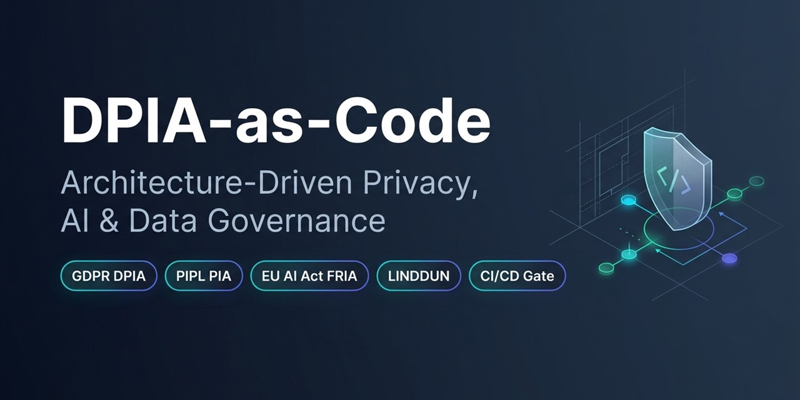
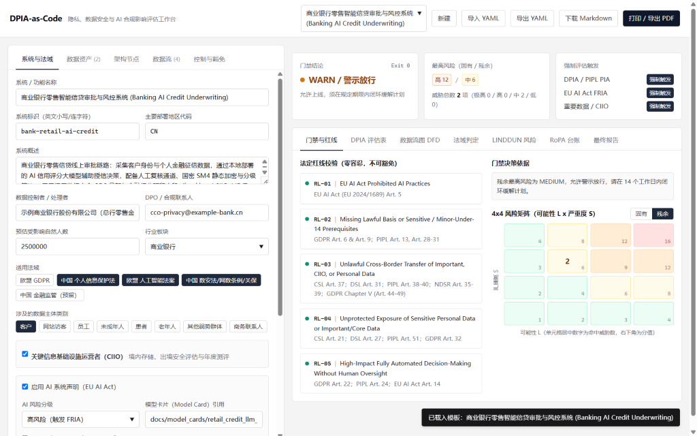
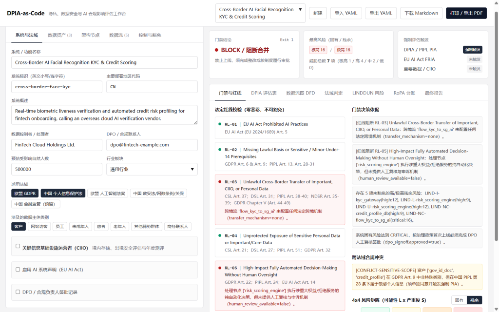
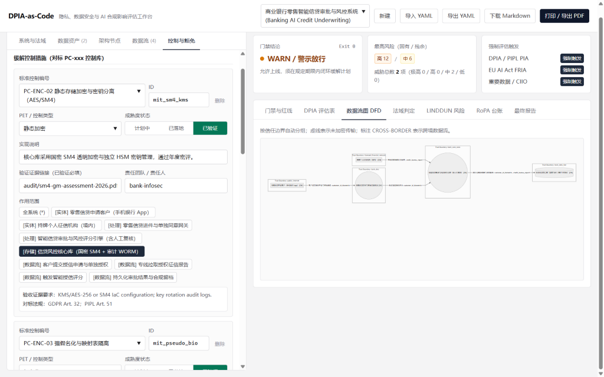

# DPIA-as-Code

[](https://github.com/DevinF1029/DPIA-as-Code/actions/workflows/dpia-gate.yml)
[](https://www.python.org/downloads/)
[](LICENSE)
[](https://github.com/DevinF1029/DPIA-as-Code/releases/tag/v0.1.0)
[](CONTRIBUTING.md)

[中文文档 (README.md)](README.md) | [Design Whitepaper (中文)](docs/项目设计与实现论文.md)

> **Governance First, Automated by Code**
>
> Architecture-driven **DPIA / PIPL PIA / EU AI Act FRIA / China Important Data Assessment** & **LINDDUN privacy threat modeling** from a single `dataflow.yaml` — generating audit-ready reports, remediation CSVs, CI/CD PR merge gates, and a no-code interactive Web Workbench for DPOs and legal teams.



---

## Workbench Preview

| Interactive Workbench (`WARN` + 4×4 Matrix) | Statutory Red-Line Gate (`BLOCK` on `RL-03` / `RL-05`) |
| :---: | :---: |
|  |  |

<details>
<summary>Expand: Real-time What-if Maturity Simulation & Auto-Generated Mermaid DFD</summary>



</details>

---

## Why DPIA-as-Code?

In privacy and AI governance, legal teams maintain static policies in wikis while engineers rapidly ship APIs and data pipelines — creating **Policy-Architecture Drift** and **paper compliance**.

**DPIA-as-Code** establishes `dataflow.yaml` as the shared **Single Source of Truth (SSOT)** across engineering, legal, and DPO teams using a four-layer GRC-as-Code architecture:

1. **Layer 1 — Governance & Standards (`governance/`)**: Enterprise policy, multi-jurisdiction Regulatory Traceability Matrix (RTM), LINDDUN × CNIL × GB/T 39335 methodology, 25-control catalog (`PC-xxx-xx`), SOP, and audit templates.
2. **Layer 2 — Policy-as-Code Rules (`rules/*.yaml`)**: Statutory zero-tolerance red lines (`RL-01`..`RL-05`), multi-jurisdiction thresholds & cross-jurisdiction conflict checks, LINDDUN mapping matrix, and structured control catalog.
3. **Layer 3 — Schema Contract (`schemas/` & `models/`)**: Strict Pydantic v2 models + JSON Schema (Draft 2020-12) validation.
4. **Layer 4 — Execution Engine, CI Gate & Web Workbench (`src/` & `.github/workflows/`)**: Automatic DFD (Mermaid) & RoPA extraction, transparent control maturity reduction (`planned = 0` to prevent compliance greenwashing), time-bounded `RiskWaiver` enforcement, PR merge gates, and a zero-build Web UI.

### Key Capabilities

- **Assess Once, Comply Many**: Covers **GDPR** (WP29 9 criteria + Art. 30 RoPA), **EU AI Act** (Art. 5 prohibited practices + Art. 27 FRIA), and **China Cybersecurity / Data Security / PIPL / NDSR** (including CIIO & Important Data triggers), with cross-jurisdiction conflict detection (e.g., blocking GDPR `legitimate_interests` under China PIPL).
- **Zero-Tolerance Red Lines + Time-Bounded Risk Waivers**: `RL-01`..`RL-05` always `BLOCK` and cannot be waived. Non-red-line high risks can use a hard-expiring `RiskWaiver` (High ≤ 90 days / Critical ≤ 30 days) that automatically re-blocks upon expiration.
- **Anti-Greenwashing Maturity Reduction**: `planned` controls receive `0` risk reduction; only `implemented` (-1 tier) and `verified` (with audit evidence) reduce residual risk. `CRITICAL` inherent risk requires `dpo_signoff.approved: true`.
- **No-Code Web Workbench & Dynamic DPIA Sheet**: DPOs and business owners can model systems step-by-step, run What-if control simulations, complete substantive reviews & sign-offs in the dynamic DPIA sheet, and export audit reports (Markdown / PDF), remediation CSVs, or `dataflow.yaml`.

---

## Quickstart

### 1. Start the Web Workbench

Requires Python `>= 3.11`:

```bash
git clone https://github.com/DevinF1029/DPIA-as-Code.git
cd DPIA-as-Code

pip install -e ".[web]"
dpia serve --port 8000
```

Open **`http://127.0.0.1:8000`** in your browser.

### 2. CLI & CI/CD Usage

```bash
# Validate architecture declaration
dpia validate examples/facial_recognition_kyc.yaml

# Generate full Chinese audit report (Markdown)
dpia assess examples/banking_retail_credit_ai.yaml --format md --output report.md

# Generate compact GitHub PR comment summary (--no-fail prints without non-zero exit)
dpia assess examples/facial_recognition_kyc.yaml --format pr-comment --no-fail

# Output structured JSON for downstream GRC platforms
dpia assess examples/static_marketing_site.yaml --format json
```

### 3. Run Tests & Linting

```bash
pip install -e ".[web,dev]"
pytest -v
ruff check src tests
```

---

## Built-in Examples (`examples/`)

| Specification (`YAML`) | Scenario | Expected Gate | Sample Report |
| :--- | :--- | :---: | :--- |
| [static_marketing_site.yaml](examples/static_marketing_site.yaml) | EU low-risk B2B contact form | `PASS` (Exit `0`) | [static_marketing_site_report.md](examples/sample_reports/static_marketing_site_report.md) |
| [facial_recognition_kyc.yaml](examples/facial_recognition_kyc.yaml) | Cross-border facial recognition KYC + automated scoring (missing safeguards) | `BLOCK` (Exit `1`, hits `RL-03` / `RL-05`) | [facial_recognition_kyc_report.md](examples/sample_reports/facial_recognition_kyc_report.md) |
| [banking_retail_credit_ai.yaml](examples/banking_retail_credit_ai.yaml) | Retail banking credit AI (CIIO + Important Data L4 + High-Risk AI + verified controls & DPO sign-off) | `WARN` (Exit `0`, triggers PIPL / DSL / FRIA) | [banking_retail_credit_report.md](examples/sample_reports/banking_retail_credit_report.md) |

---

## Disclaimer

This tool generates automated assessment drafts and engineering CI/CD gate signals. It **does not constitute legal advice** and does not replace substantive legal review by a Data Protection Officer (DPO), legal counsel, or mandatory prior regulatory consultations. Please review and adapt the rule packs to your organization's applicable jurisdictions.

## License

Licensed under the **Apache License 2.0** — see [LICENSE](LICENSE) for details.
