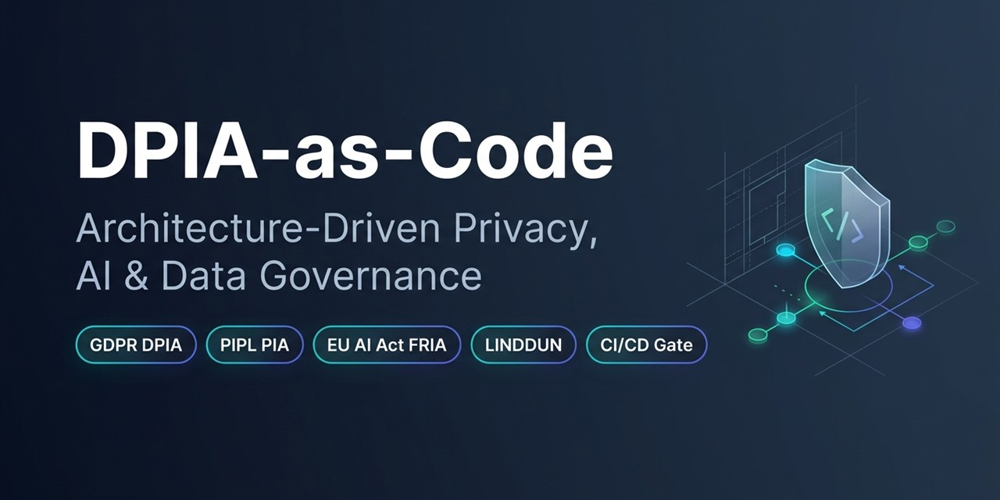
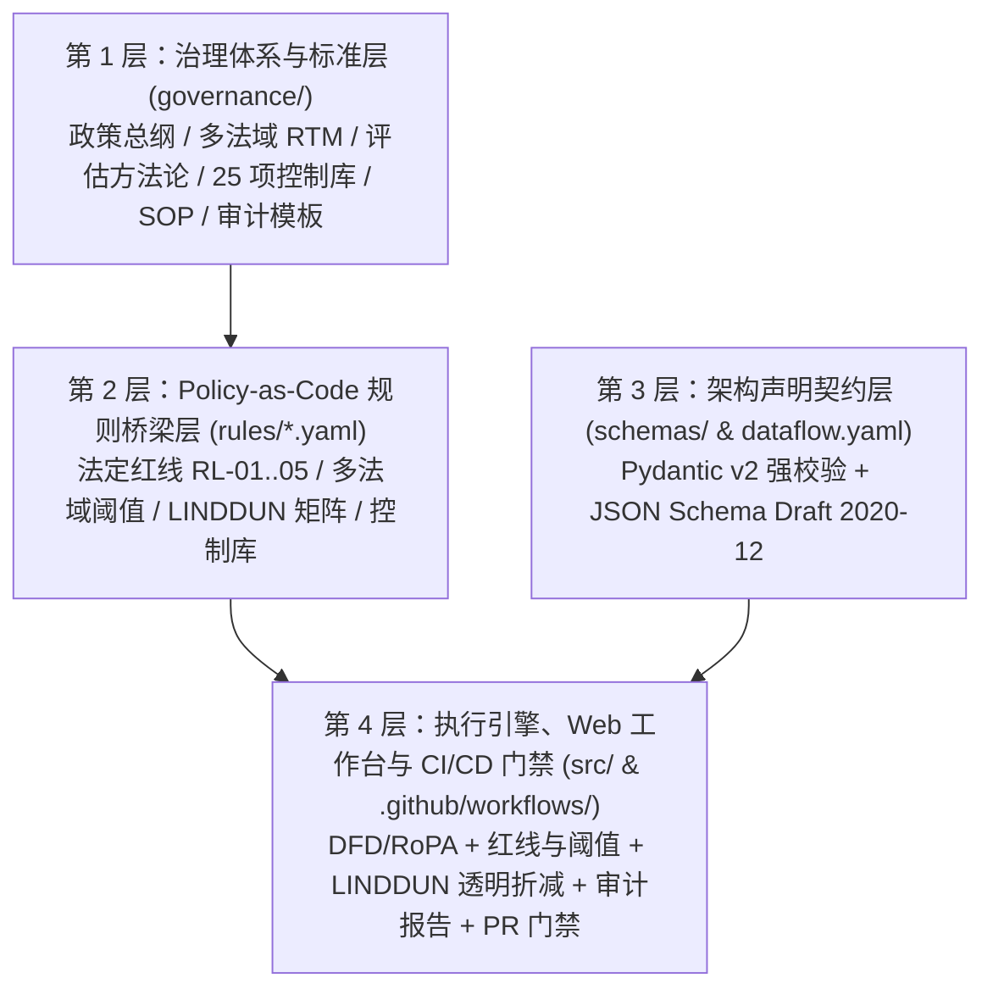
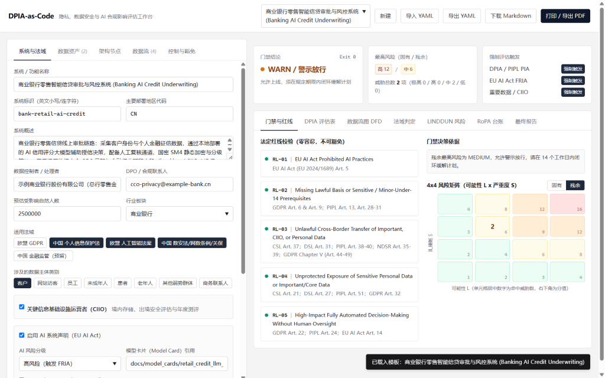
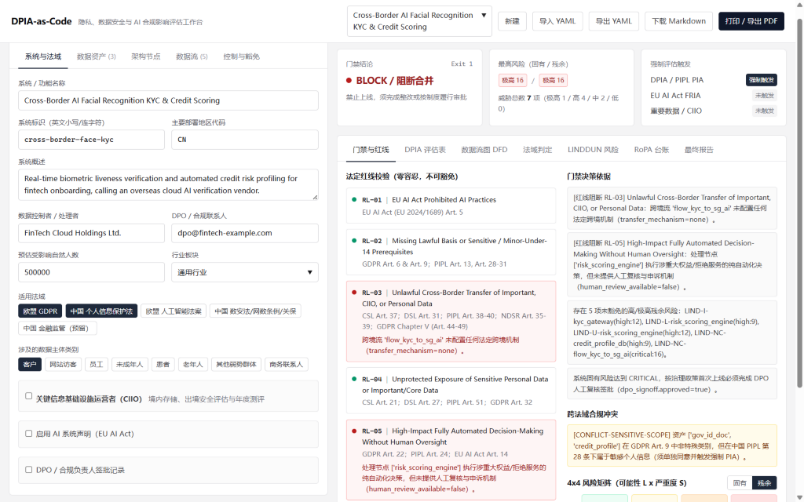
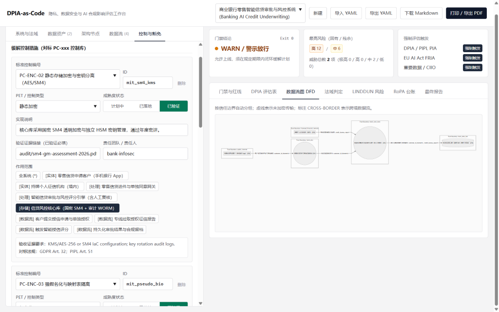

# DPIA-as-Code

[](https://github.com/DevinF1029/DPIA-as-Code/actions/workflows/dpia-gate.yml)
[](https://www.python.org/downloads/)
[](LICENSE)
[](https://github.com/DevinF1029/DPIA-as-Code/releases/tag/v0.1.0)
[](CONTRIBUTING.md)

[English README](README.en.md) | [项目设计与实现论文](docs/项目设计与实现论文.md) | [更新日志 (CHANGELOG)](CHANGELOG.md)

> **Governance First, Automated by Code（治理体系为本，工程代码为用）**
>
> 基于架构声明文件（`dataflow.yaml`）的自动化 **DPIA / PIPL PIA / EU AI Act FRIA / 中国重要数据评估** 与 **LINDDUN 隐私威胁建模** 引擎，提供 **CI/CD 合并门禁** 与面向非技术人员的 **交互式 Web 合规评估工作台**。



---

## 一、 核心痛点与架构理念

在企业隐私与数据安全治理实践中，法务与合规团队在文档库中维护制度，而研发团队在代码库中高频迭代接口，极易形成**“政策与架构双轨漂移（Policy-Architecture Drift）”**与**“纸面合规”**。

**DPIA-as-Code** 将架构声明 `dataflow.yaml` 确立为业务、合规与研发共享的**单一事实来源（Single Source of Truth, SSOT）**，通过四层 GRC-as-Code 架构实现“架构一改，影响评估自动重算”：



### 核心能力

* **一次建图，多法域映射（Assess Once, Comply Many）**：原生覆盖 **GDPR**（WP29 9 项标准 + Art. 30 RoPA）、**EU AI Act**（Art. 5 禁止类红线 + Art. 27 FRIA）、**中国“三法两条例”**（CSL / DSL / PIPL 第 55 条 / CIIO / 《网络数据安全管理条例》），内置**跨法域冲突校验**（如在中国 PIPL 下误用 GDPR `legitimate_interests` 直接阻断）。
* **法定红线零容忍 + 限时风险豁免（Risk Waiver）**：命中 `RL-01`..`RL-05` 强制 `BLOCK` 且严禁豁免；非红线高风险可走带**硬性到期日**的 `RiskWaiver`（High ≤ 90 天 / Critical ≤ 30 天），到期后自动恢复阻断。
* **防“纸面洗绿”的透明成熟度折减**：`planned` 控制折减系数为 `0`（不降分），仅 `implemented`（降 1 档）与附带审计证据的 `verified` 控制可实质降低残余风险；固有风险达到 `CRITICAL` 时强制要求 `dpo_signoff.approved: true`。
* **通用数据安全 GRC 为本，预留金融行业扩展口子**：在模型中预留可选 `industry_sector`（`banking` / `insurance` 等）、`is_ciio`、`financial_data_level`（对标 JR/T 0197 `L1`–`L5`）与 `Jurisdiction.CN_FIN_NFRA`。
* **面向非程序员的交互式 Web 工作台与动态 DPIA 评估表**：法务、DPO 与业务负责人可在浏览器中通过分步表单填报、切换控制成熟度做 What-if 模拟、在**动态 DPIA 评估表**中在线补全实质审查/整改排期/三方签批（按需自动展开 FRIA 与重要数据章节），一键导出无占位符中文审计报告（Markdown / PDF）、整改台账（CSV）及标准 `dataflow.yaml`。

### 界面预览与门禁效果

| Web 工作台总览（银行信贷 AI：`WARN` 警示放行 + 4×4 风险矩阵） | 红线阻断状态（跨境人脸识别 KYC：`BLOCK` 命中 `RL-03` / `RL-05`） |
| :---: | :---: |
|  |  |

<details>
<summary>展开查看：What-if 控制成熟度模拟与自动生成的信任边界 DFD 数据流图</summary>



</details>

---

## 二、 如何手动启动 Web 合规评估工作台

### 环境要求

* Python `>= 3.11`

### 方式一：标准安装并启动（推荐）

```bash
# 1. 克隆仓库并进入项目根目录
git clone https://github.com/DevinF1029/DPIA-as-Code.git
cd DPIA-as-Code

# 2. 安装项目及 Web 依赖（FastAPI + Uvicorn）
pip install -e ".[web]"

# 3. 启动本地 Web 工作台（默认监听 127.0.0.1:8000）
dpia serve --port 8000
```

### 方式二：免安装直接启动（适合快速试用或未安装 setuptools 的环境）

```bash
# 1. 安装基础与 Web 依赖
pip install pydantic PyYAML jsonschema Jinja2 click fastapi uvicorn

# 2. 直接通过 Uvicorn 启动（Windows PowerShell / macOS / Linux 通用）
python -m uvicorn --app-dir src dpia_as_code.web.api:app --host 127.0.0.1 --port 8000
```

启动成功后，在浏览器访问：**`http://127.0.0.1:8000`**。按 `Ctrl + C` 即可停止服务。

> **局域网共享提示**：如需同网段同事访问，可将 `--host` 参数改为 `0.0.0.0`（例如 `--host 0.0.0.0 --port 8000`）。

---

## 三、 CLI 命令行与单元测试用法

### CLI 命令（适合研发与 CI/CD 流水线）

```bash
# 校验架构声明文件合法性
dpia validate examples/facial_recognition_kyc.yaml

# 生成完整中文审计级 DPIA / PIA / FRIA 报告
dpia assess examples/banking_retail_credit_ai.yaml --format md --output report.md

# 生成 GitHub Actions PR 评论精简摘要（--no-fail 仅输出不返回非零退出码）
dpia assess examples/facial_recognition_kyc.yaml --format pr-comment --no-fail

# 输出结构化 JSON 供下游 GRC 平台消费
dpia assess examples/static_marketing_site.yaml --format json
```

> 若未执行 `pip install -e .`，在 Windows PowerShell 中可通过 `$env:PYTHONPATH="src"; python -m dpia_as_code.cli ...`（macOS/Linux 为 `PYTHONPATH=src python -m dpia_as_code.cli ...`）直接调用。

### 运行全套单元测试与静态检查

```bash
# 安装开发依赖（pytest / ruff / httpx）
pip install -e ".[web,dev]"

# 运行全套单元测试（pytest 或 unittest 均可）
pytest -v
python -m unittest discover -s tests -v

# 代码风格与静态检查
ruff check src tests
```

### 重新导出 JSON Schema（修改 Pydantic 模型后执行）

```bash
python -m dpia_as_code.schema_export
```

### 在 GitHub 仓库中启用 PR 强制合并门禁（Branch Protection）

仓库已内置 [dpia-gate.yml](.github/workflows/dpia-gate.yml)，会在 PR 时自动运行测试并贴出风险摘要评论。若需在合并前**硬性阻断**高风险 PR，请在仓库网页端进行一次配置：

1. 进入 `Settings -> Branches -> Add branch protection rule`（或 Rulesets），填写目标分支 `main`；
2. 勾选 **Require status checks to pass before merging**；
3. 搜索并添加以下两个必选检查：
   - `Unit Tests & Schema Integrity`
   - `DPIA / PIA / FRIA Gate & PR Comment`

---

## 四、 内置示例架构与产出报告对照（`examples/`）

| 输入架构声明（YAML） | 业务场景说明 | 预期门禁结果 | 对应生成的中文审计报告 |
| :--- | :--- | :---: | :--- |
| [static_marketing_site.yaml](examples/static_marketing_site.yaml) | 欧盟境内低风险 B2B 官网联系表单 | `PASS` (Exit `0`) | [static_marketing_site_report.md](examples/sample_reports/static_marketing_site_report.md) |
| [facial_recognition_kyc.yaml](examples/facial_recognition_kyc.yaml) | 跨境人脸识别 KYC + 自动化信用评分（缺失跨境机制与人工复核） | `BLOCK` (Exit `1`，命中 `RL-03` / `RL-05`) | [facial_recognition_kyc_report.md](examples/sample_reports/facial_recognition_kyc_report.md) |
| [banking_retail_credit_ai.yaml](examples/banking_retail_credit_ai.yaml) | 商业银行零售智能信贷审批（CIIO + 重要数据 L4 + 高风险 AI + `verified` 控制与 DPO 签批） | `WARN` (Exit `0`，触发 PIPL / DSL / FRIA) | [banking_retail_credit_report.md](examples/sample_reports/banking_retail_credit_report.md) |

---

## 五、 项目完整文件树

```text
DPIA-as-Code/
├── .github/
│   ├── ISSUE_TEMPLATE/                     # Bug / 新法域规则 / 功能建议 Issue 模板
│   ├── pull_request_template.md            # PR 检查清单（测试 / Ruff / Schema 导出）
│   └── workflows/
│       └── dpia-gate.yml                   # GitHub Actions CI/CD 门禁、报告归档与自动 PR 评论
├── .gitignore                              # Git 忽略规则（artifacts/、缓存等）
├── CHANGELOG.md                            # 版本变更记录
├── CODE_OF_CONDUCT.md                      # 社区行为准则
├── CONTRIBUTING.md                         # 贡献指南与规则提交规范
├── LICENSE                                 # Apache License 2.0 全文
├── SECURITY.md                             # 安全漏洞与门禁绕过私密报告指南
├── pyproject.toml                          # 项目元数据、依赖与 `dpia` CLI 入口配置
├── README.md                               # 中文项目总览与使用手册
├── README.en.md                            # English README
├── docs/
│   ├── images/                             # Social Preview 封面与 Web 工作台截图
│   └── 项目设计与实现论文.md                 # 完整的项目设计、方法论与实现说明论文（白皮书）
├── governance/                             # 第 1 层：人可读治理体系与审计模板
│   ├── README.md                           # 治理体系总览与四层架构说明
│   ├── 01_governance_policy.md             # 治理总纲、三道防线 RACI、法定红线与豁免政策
│   ├── 02_regulatory_matrix.md             # 多法域法规追溯矩阵（GDPR / EU AI Act / 三法两条例）
│   ├── 03_assessment_methodology.md        # 整合式评估方法论（LINDDUN × CNIL × GB/T 39335）
│   ├── 04_control_catalog.md               # 6 大控制域 25 项标准控制库（PC-xxx-xx）与审计证据
│   ├── 05_dpia_lifecycle_sop.md            # 全生命周期作业流程（SOP）与 3 年归档规范
│   └── templates/
│       ├── dpia_report_template.md         # 审计级综合影响评估报告模板（TPL-DPIA-001）
│       ├── risk_waiver_template.md         # 高风险限时豁免申请单模板
│       └── ropa_template.md                # 处理活动记录（RoPA）台账模板
├── rules/                                  # 第 2 层：Policy-as-Code 机器可读规则包
│   ├── red_lines.yaml                      # 法定零容忍红线规则（RL-01 .. RL-05）
│   ├── thresholds.yaml                     # 多法域强制评估触发条件与跨法域冲突规则
│   ├── linddun_matrix.yaml                 # DFD × LINDDUN 映射矩阵、打分锚点与折减参数
│   └── control_catalog.yaml                # 25 项 PC-xxx-xx 控制结构化目录
├── schemas/                                # 第 3 层：架构声明契约 Schema
│   └── dataflow.schema.json                # 自动导出的 JSON Schema (Draft 2020-12)
├── examples/                               # 多行业参考 dataflow.yaml 示例与产出报告样例
│   ├── static_marketing_site.yaml          # 低风险官网表单示例（PASS）
│   ├── facial_recognition_kyc.yaml         # 跨境人脸识别 KYC 示例（BLOCK）
│   ├── banking_retail_credit_ai.yaml       # 商业银行零售智能信贷示例（WARN）
│   └── sample_reports/                     # 与上述输入一一对应的中文审计报告样例 (*.md)
├── src/
│   └── dpia_as_code/                       # 第 4 层：Python 核心引擎、CLI 与 Web 工作台
│       ├── __init__.py
│       ├── loader.py                       # YAML 加载、Pydantic 校验与 JSON Schema 导出
│       ├── rules_loader.py                 # rules/*.yaml 强类型加载与跨文件完整性校验
│       ├── schema_export.py                # Schema 导出脚本
│       ├── reporter.py                     # 中文审计 Markdown、PR 评论摘要与 JSON 渲染器
│       ├── cli.py                          # `dpia` CLI（validate / assess / serve）
│       ├── models/
│       │   ├── __init__.py
│       │   ├── enums.py                    # 法域、数据类别、分类分级、AI 风险与金融预留枚举
│       │   ├── dataflow.py                 # dataflow.yaml 输入模型（含 AISystem / RiskWaiver）
│       │   └── assessment.py               # 评估输出契约模型（RoPA / Finding / Gate / Report）
│       ├── engines/
│       │   ├── __init__.py
│       │   ├── dfd_parser.py               # Mermaid DFD 生成器与 RoPA 提取器
│       │   ├── threshold_engine.py         # 红线校验、多法域触发与跨法域冲突引擎
│       │   ├── linddun_scorer.py           # LINDDUN 威胁映射与 CNIL × GB/T 39335 透明折减打分
│       │   ├── gate.py                     # CI/CD 门禁决策与 Waiver 到期核验引擎
│       │   └── pipeline.py                 # 端到端评估编排入口 `assess_dataflow()`
│       └── web/
│           ├── __init__.py
│           ├── api.py                      # FastAPI REST API 与中文化元数据接口
│           └── static/
│               ├── index.html              # 零构建交互式单页合规评估工作台
│               └── app.js                  # Alpine.js 状态管理、实时重算与 PDF 导出逻辑
├── tests/                                  # 全链路单元测试（37 项用例）
│   ├── test_models.py                      # 数据模型、Waiver 策略与 JSON Schema 校验测试
│   ├── test_rules.py                       # Policy-as-Code 规则包加载与跨引用完整性测试
│   ├── test_engines.py                     # 引擎端到端与边界场景测试
│   ├── test_cli.py                         # CLI 命令与中文报告输出测试
│   └── test_web.py                         # FastAPI 工作台接口与 422 校验测试
└── topic/                                  # 项目立项背景与阶段工作日志
    ├── 主题.txt                            # 初始项目立项构想
    └── 工作日志.md                         # 各阶段研发进展与架构决策记录
```

---

## 六、 免责声明与许可证

### 免责声明

本项目输出的是自动化评估草稿与工程门禁信号，**不构成法律意见**，也不替代 DPO / 法务的实质审查与监管事前咨询。规则包与控制项请结合组织实际适用法域与监管要求复核后使用。

### 许可证

本项目采用 **Apache License 2.0** 开源协议发布 — 详见 [LICENSE](LICENSE)。
