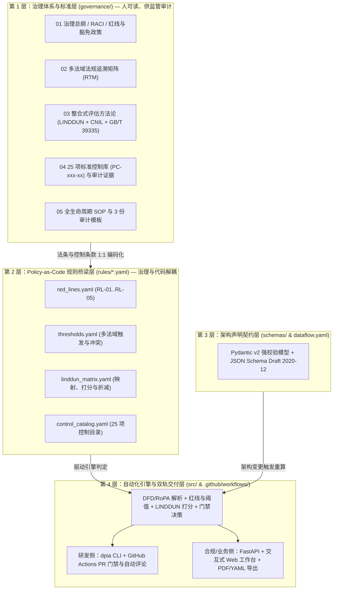

# DPIA-as-Code：基于架构声明的多法域隐私、数据安全与 AI 合规自动化评估治理体系设计与实现

---

## 摘要

随着欧盟《通用数据保护条例》（GDPR）、欧盟《人工智能法案》（EU AI Act）以及中国《网络安全法》《数据安全法》《个人信息保护法》《关键信息基础设施安全保护条例》和《网络数据安全管理条例》（“三法两条例”）的全面落地，企业在数据处理与人工智能应用上面临日益严密的多法域、穿透式合规监管。然而，传统依赖静态 Word 制度、人工问卷与事后审计的合规治理模式，普遍存在“政策与架构双轨漂移”“多法域重复评估疲劳”以及“纸面合规与永久豁免债务”三大结构性失效。

针对上述痛点，本项目提出并实现了 **DPIA-as-Code**——一套秉持 **“治理体系为本，工程代码为用（Governance First, Automated by Code）”** 理念的自动化隐私、数据安全与 AI 合规治理系统。项目将系统架构声明文件 `dataflow.yaml` 确立为研发、业务与合规团队共享的单一事实来源（Single Source of Truth），构建了涵盖“治理文档层—Policy-as-Code 规则桥梁层—架构契约层—执行引擎与交互交付层”的四层 GRC-as-Code 架构。通过整合 LINDDUN 隐私威胁建模、法国 CNIL PIA 与中国国标 GB/T 39335 量化矩阵，并引入法定红线零容忍拦截、基于控制成熟度的防洗绿折减算法及带硬性到期日的限时风险豁免机制，系统同时打通了面向研发的 CI/CD 合并门禁与面向非技术人员的交互式 Web 合规工作台。经 37 项自动化单元测试与三类典型行业场景（含商业银行智能信贷风控）实测验证，系统能够准确识别跨法域冲突、法定红线与残余风险，有效实现了隐私与数据安全治理的左移与持续问责。

**关键词**：隐私影响评估（DPIA/PIA）；基本权利影响评估（FRIA）；GRC-as-Code；LINDDUN 威胁建模；Policy-as-Code；数据安全治理；CI/CD 合规门禁

---

## 第 1 章 绪论：项目背景与问题提出

### 1.1 强监管时代的企业合规挑战

当前全球数据与人工智能治理正从“原则倡导”全面迈入“强执法、高罚金、穿透追责”阶段。对于同时涉及个人数据、敏感金融/生物特征数据以及算法决策的现代数字化系统，单一业务迭代往往同时触及多套强制性规范：

* **欧盟法域**：GDPR 第 35 条要求高风险处理活动上线前必须开展数据保护影响评估（DPIA），第 30 条要求持续维护处理活动记录（RoPA）；EU AI Act（2024）进一步确立了 Art. 5 禁止类 AI 实践红线，并要求高风险 AI 系统部署前开展基本权利影响评估（FRIA）。
* **中国法域**：“三法两条例”确立了数据分类分级（一般/重要/核心数据）、关键信息基础设施运营者（CIIO）本地化存储与安全评估、个人信息保护影响评估（PIPL 第 55 条强制五类情形与第 56 条三年留存义务）、以及处理千万人以上个人信息的加重保护义务。
* **行业叠加约束**：在商业银行、保险等强牌照金融行业，监管机构在上位法之外叠加了行业数据安全管理办法与分类分级标准（如 JR/T 0197），且实行“双罚制”（罚机构与罚高管并重），信息科技与数据安全风险直接挂钩监管评级与资本计提。

### 1.2 传统治理模式的三大结构性痛点

在实际企业运作中，传统以法务/合规部门手工驱动的 GRC（治理、风险与合规）模式与敏捷研发节奏严重脱节，暴露出三个核心痛点：

1. **制度与现实的“双轨漂移”（Policy-Architecture Drift）**
   合规团队在文档库中维护数百页静态制度，而研发团队每周在代码库中高频迭代接口。当业务新增“人脸活体识别”“用户画像打分”或接入境外 AI 服务商时，合规团队往往在功能上线数月甚至监管问询后才知情，导致“设计即保护（Privacy by Design）”沦为空谈。
2. **多法域重复评估导致的“合规疲劳”（Assessment Fatigue）**
   同一项涉 AI 或跨境业务，常需分别应付 GDPR DPIA、EU AI Act FRIA、中国 PIPL PIA 及重要数据风险评估。各合规条线孤立建表不仅造成研发抵触，还极易出现跨法域法条误用（例如在中国业务中错误套用 GDPR 独有的“合法利益”合法性基础）。
3. **“纸面合规”与“永久豁免”陷阱（Checkbox Compliance）**
   在缺乏客观证据约束的问卷式评审中，业务方常以“计划下季度做加密/脱敏”等口头承诺换取上线放行；或者以“临时特批”绕过高风险拦截，却缺乏到期自动回收机制，导致高风险长期滞留生产环境，既无法抵御真实数据泄露，也经不起监管审计追责。

### 1.3 项目诞生初衷与核心理念

**DPIA-as-Code** 正是为破解上述三大结构性失效而诞生。项目确立了一项贯穿始终的核心设计原则：**Governance First, Automated by Code（治理体系为本，工程代码为用）**。

技术工具本身不能凭空产生合规，严密的治理制度、清晰的权责划分与可解释的风险口径才是根基。因此，本项目并非简单编写一个扫描脚本，而是先自顶向下建立一套人可读、供监管审计的完整治理体系，再将治理规则 1:1 翻译为机器可读的 Policy-as-Code 规则包，由自动化引擎充当合规政策的**“执行翻译器、持续监测器与客观取证器”**。

---

## 第 2 章 总体治理框架与四层架构设计

### 2.1 四层 GRC-as-Code 分层架构

为实现“制度可审计、规则可配置、架构可校验、执行可阻断”的目标，系统采用解耦的四层架构设计：

这一分层架构保证了：当外部法规更新或企业调整风险偏好时，合规团队只需修订 `governance/` 文档与对应的 `rules/*.yaml` 规则包，而无需大规模重写 Python 引擎代码；同时，每一条自动化门禁拦截都能反向精确追溯至具体法条与内部控制编号。

### 2.2 人机分工边界与三道防线

系统严格界定了**自动化引擎**与**人工治理主体**的权责边界，避免盲目依赖自动化：

* **自动化引擎负责（客观事实与一致性）**：校验架构声明语法与拓扑完整性；检测未加密传输、缺失合法性基础、非法跨境与跨法域冲突；判定法定强制评估阈值；映射 LINDDUN 威胁并按公开公式计算固有/残余分值；校验控制证据完整性与豁免单是否过期。
* **DPO / 业务与风控负责人负责（主观价值与实质裁量）**：判断敏感数据采集是否满足“最小必要与比例性原则”；评估高风险 AI 模型对弱势群体是否构成隐性歧视；审批非红线高风险的限时豁免及发起监管事前咨询。在系统生成的中文审计报告中，专门保留了“合法性、必要性与比例性实质审查”与“最终签批页”人工章节。

在组织落地上，治理体系严格对齐 IIA **三道防线模型**：第一道防线（业务负责人与研发）负责维护 `dataflow.yaml` 与落实控制；第二道防线（隐私工程/安全团队）与独立监督层（DPO/法务合规）负责规则制定、技术验收与高风险把关；第三道防线（内审/外审）依托系统生成的不可篡改台账与三年归档报告开展独立抽查。

### 2.3 双轨风险治理政策：法定红线 vs. 风险偏好

系统在门禁决策层清晰区分了两类风险，避免“一刀切”或“无底线妥协”：

1. **五项法定合规红线（Zero-Tolerance Red Lines，绝对禁止、不可豁免）**：
   * `RL-01`：EU AI Act Art. 5 禁止类 AI 实践（如社会信用评分、无差别抓取人脸建库等）；
   * `RL-02`：缺失合法性基础（`unspecified`），或中国 PIPL 敏感个人信息未取得单独同意等法定前提；
   * `RL-03`：重要数据/CIIO 数据未经网信办安全评估出境，或个人数据出境未配置任何法定机制；
   * `RL-04`：高敏个人数据或重要/核心数据明文传输，或存储端同时缺失静态加密与访问控制；
   * `RL-05`：涉重大权益或拒绝服务的纯自动化决策缺失人工复核与申诉通道。
2. **四级风险偏好与限时豁免阀门**：
   对于未触犯红线的残余风险，按 `1–4`（Low，PASS 自动放行）、`5–8`（Medium，WARN 警示放行并限期 14 个工作日整改）、`9–12`（High，BLOCK 阻断）、`13–16`（Critical，HARD BLOCK 强制阻断）分级治理。针对确有商业必要性的非红线高风险，系统允许提交结构化 `RiskWaiver` 豁免单，但强制校验四要件（商业必要性、临时补偿性控制、整改工单、硬性到期日），其中 High 风险最长豁免 **90 天**、Critical 风险最长 **30 天**，到期后门禁自动恢复 `BLOCK`。

---

## 第 3 章 多法域法规映射与方法论融合设计

### 3.1 “一次建图，多法域映射”与跨法域冲突校验

系统通过 `dataflow.yaml` 一次盘点数据资产、外部实体、处理节点、数据存储与数据流，即可并发驱动四大法域引擎：
* **GDPR**：内置 WP29/EDPB 9 项标准（命中 ≥ 2 项强制触发 DPIA）与 Art. 30 RoPA 自动提取；
* **PIPL**：内置第 55 条 5 类法定情形（命中 ≥ 1 项强制触发 PIA）及 1 万/10 万/100 万/1000 万四级人数阶梯；
* **EU AI Act**：自动识别禁止类实践与 Annex III 高风险场景，按需激活 Art. 27 FRIA 专项评估；
* **中国 DSL / CIIO / 网数条例**：依据 `data_classification`（一般/重要/核心）、`is_ciio` 与千万人规模自动触发重要数据年度风险评估。

针对跨国或双合规场景，引擎特别内置了**跨法域法条冲突检测**：
* **合法性基础冲突**：若系统同时声明适用 `GDPR` 与 `PIPL`，且处理节点使用了 `legitimate_interests`（合法利益），引擎直接阻断并提示中国个保法第 13 条无此基础；
* **敏感口径差异**：`financial_account`（金融账户）、`precise_location`（行踪轨迹）与 `government_id`（身份证件）在 PIPL 第 28 条下自动判定为敏感个人信息，而在 GDPR Art. 9 下不误判为特殊类别数据，按法域分别精准计算。

### 3.2 LINDDUN × CNIL PIA × GB/T 39335 透明打分与防洗绿折减

为消除传统风险评估中的“黑盒打分”与“全节点贴标签噪音”，系统融合了三大权威方法论：

1. **LINDDUN 矩阵与二级裁剪**：严格按 DFD 元素类型（外部实体、处理进程、数据存储、数据流）映射 7 类隐私威胁，并结合上下文进行二级裁剪——自动排除匿名化及纯非个人一般数据，仅在存在真实短板（如未加密、缺告知、无限期留存、跨库画像等）时精准生成发现项。
2. **4 × 4 量化锚点**：依据 CNIL PIA 与 GB/T 39335-2020 定义 `可能性 (L = 1..4) × 严重度 (S = 1..4)` 四级公开锚点，确保不同审计师复核同一份架构文件得出一致分值。
3. **控制成熟度折减规则（杜绝纸面合规）**：
   * `planned`（计划中）：折减系数为 **0**，不降低残余风险分值，仅单列为待落地计划项；
   * `implemented`（已落地）：最多降低 **1 档**；
   * `verified`（已验证）：强制要求填写可核验的 `evidence` 证据引用，按 `control_catalog.yaml` 定义上限完全折减。
   * **防作弊约束**：纯加密或访问控制类措施仅降低发生可能性（`L`），不降低生物识别/重要数据带来的固有严重度（`S`）；且即使残余风险已降级，只要**固有风险为 `CRITICAL`**，首次上线仍须具备 `dpo_signoff.approved: true`。

### 3.3 通用骨架与金融行业特异性预留

在坚持通用数据安全 GRC 主轴的基础上，结合商业银行与保险业强牌照、重审计的行业特征，模型层以零侵入方式预留了金融行业扩展接口：包括 `SystemMetadata.industry_sector`（`general` / `banking` / `insurance` 等）、`SystemMetadata.is_ciio`、`DataAsset.financial_data_level`（对标人行行标 JR/T 0197 的 `L1`–`L5` 五级分类）以及 `Jurisdiction.CN_FIN_NFRA`，便于后续无缝挂载银保专项规则包。

---

## 第 4 章 系统核心模块实现

### 4.1 契约与规则桥梁层实现

* **强类型领域模型（`src/dpia_as_code/models/`）**：基于 Pydantic v2 构建，全面启用 `extra="forbid"` 拦截拼写错误；实现节点与数据流 ID 唯一性、跨节点引用完整性、自环边拦截、`verified` 控制必填证据、以及 `RiskWaiver` 最长有效期与红线排除的声明期强校验；并通过 `schema_export.py` 自动导出标准 JSON Schema（Draft 2020-12）供 IDE 实时补全。
* **Policy-as-Code 规则包与校验加载器（`rules/*.yaml` & `rules_loader.py`）**：将 `governance/01`–`04` 结构化落盘为 `red_lines.yaml`、`thresholds.yaml`、`linddun_matrix.yaml` 与 `control_catalog.yaml`（6 大控制域共 25 项 `PC-xxx-xx` 控制）。`load_rule_bundle()` 启动时自动执行跨文件引用完整性检查，确保阈值规则引用的每一项控制编号均真实存在于控制目录中。

### 4.2 核心自动化分析引擎实现

引擎层位于 `src/dpia_as_code/engines/`，由 `pipeline.py` 中的 `assess_dataflow()` 统一编排：
* **DFD & RoPA 解析器（`dfd_parser.py`）**：按 `trust_boundary` 自动分组生成 Mermaid 数据流向图（虚线标注未加密传输，边标签自动标出 `CROSS-BORDER`），并沿有向边聚合每个处理节点的 RoPA 台账草案。
* **红线与多法域阈值引擎（`threshold_engine.py`）**：动态加载规则包，产出 `RedLineViolation` 与 `ThresholdAssessment`（含 `fria_required`、`important_data_assessment_required` 与 `jurisdiction_conflicts`）。
* **LINDDUN 威胁映射与打分器（`linddun_scorer.py`）**：优先按 `control_id`（`PC-xxx-xx`）精确匹配控制库折减权重，未指定时自动回退至 `pet_type` 匹配，输出每条威胁的固有/残余分值与推荐 PETs。
* **门禁决策引擎（`gate.py`）**：严格按照“法定红线 → 跨法域冲突 → Waiver 时效核验 → 未豁免高/极高残余风险 → 高固有风险 DPO 签批 → Medium/Low”优先级输出 `GateDecision` 与 CI 退出码（`0` 或 `1`）。

### 4.3 面向双人群的交付界面实现

为兼顾工程团队的自动化习惯与法务/合规团队的非技术背景，系统提供两套无缝互通的交付入口：

1. **面向研发与 DevSecOps：`dpia` CLI 与 GitHub Actions 门禁**
   提供 `dpia validate`、`dpia assess`（支持 `md` / `pr-comment` / `json` 三种格式）与 `dpia serve` 子命令。配套的 `.github/workflows/dpia-gate.yml` 在 PR 提交时自动运行单元测试与合规评估，幂等更新 PR 评论区中文风险摘要、上传完整审计报告 Artifact（保留 90 天），并在命中 `BLOCK` 时阻断代码合并。
2. **面向法务、DPO 与业务方：交互式 Web 合规评估工作台**
   采用 **FastAPI 后端 + 零构建单页前端**（Tailwind CSS + Alpine.js + Mermaid.js + Marked.js），采用克制的企业级后台视觉规范（无装饰表情、清晰中性色阶与等宽编码排版）。非技术人员可通过左侧 5 步可视化表单零代码建档，切换控制成熟度即时开展 What-if 模拟，在右侧同步查看门禁结论、红线状态、4×4 风险矩阵、Mermaid DFD 图与中文审计报告，并支持一键打印 PDF 及双向导入/导出标准 `dataflow.yaml`。

---

## 第 5 章 系统验证与典型场景实测分析

### 5.1 自动化测试体系

项目在 `tests/` 目录下建立了覆盖全链路的 **37 项自动化单元测试**（运行耗时不足 1 秒，全部通过），覆盖范围包括：
* `test_models.py`：Pydantic 校验边界、Waiver 超期/靶向红线拦截、非个人重要数据跨境判定、JSON Schema Draft 2020-12 同步一致性；
* `test_rules.py`：4 份 YAML 规则包结构校验与跨文件引用完整性；
* `test_engines.py`：多法域触发、红线阻断、跨法域 `legitimate_interests` 冲突、Waiver 生效与到期自动转阻断、`planned` 不降分等核心治理逻辑；
* `test_cli.py` & `test_web.py`：CLI 退出码、中文报告渲染以及 FastAPI 全部 REST 接口与 422 结构化报错。

### 5.2 三类典型场景实测对比

| 测试场景样本 | 架构核心特征 | 触发评估类型 | 固有 → 残余最高风险 | 门禁结论 | 验证的核心能力 |
| :--- | :--- | :--- | :---: | :---: | :--- |
| **欧盟低风险官网表单** `static_marketing_site.yaml` | 欧盟境内、小规模一般联系信息、全链路加密与 90 天清理 | 均未触发 | `LOW (0)` → `LOW (0)` | **PASS** (`0`) | 避免低风险场景误报与过度合规干扰 |
| **跨境人脸识别 KYC 与信贷评分** `facial_recognition_kyc.yaml` | 生物特征跨境至新加坡且 `transfer_mechanism=none`；自动化拒贷无人工复核；缓解项为 `planned` | GDPR DPIA PIPL PIA | `CRITICAL (16)` → `CRITICAL (16)` | **BLOCK** (`1`) | 精准拦截 `RL-03` / `RL-05` 红线；验证 `planned` 控制不降分防洗绿 |
| **商业银行零售智能信贷审批** `banking_retail_credit_ai.yaml` | 境内 CIIO 银行、重要数据 L4、高风险 AI、国密 SM4/令牌化/人工复核均为 `verified` 且有 DPO 签批 | PIPL PIA EU AI Act FRIA 重要数据评估 | `HIGH (12)` → `MEDIUM (6)` | **WARN** (`0`) | 验证通用骨架与金融预留字段协同、`verified` 控制有效折减与多评估整合输出 |

---

## 第 6 章 项目价值总结

对照第 1 章提出的三大结构性痛点，**DPIA-as-Code** 在治理体系与工程实践层面实现了闭环求解：

1. **终结“双轨漂移”**：通过 `dataflow.yaml` 单一事实来源与 CI/CD 自动化门禁，使隐私与数据安全评估与架构演进强绑定，任何新增高敏采集、跨境调用或自动化决策均无法绕过合规视野。
2. **消除“合规疲劳”**：通过统一的 Policy-as-Code 规则桥梁层，实现一次架构申报同步产出 GDPR DPIA、RoPA、EU AI Act FRIA 与中国 PIPL/重要数据评估结论，并自动预警跨法域法条冲突。
3. **根治“纸面合规”与“永久豁免”**：通过证据驱动的成熟度折减机制（`planned` 不降分）、高固有风险 DPO 强制复核补丁、不可豁免的法定红线清单以及到期自动失效的 `RiskWaiver`，确保每一项合规放行均经得起内外审与监管核查。
4. **打通“非技术人员 ↔ 研发团队”协作断点**：交互式 Web 工作台让法务、DPO 与业务负责人无需编写 YAML 即可直观建模、模拟整改效果并输出审计级 PDF 报告，同时一键导出标准 `dataflow.yaml` 纳入代码库持续守护。

---

## 第 7 章 局限性与未来演进方向

作为面向通用数据安全 GRC 治理的体系化原型，本项目在真实大型企业（尤其是大型商业银行与保险机构）全面生产化部署前，仍有以下四个高价值演进方向：

1. **架构声明的自动发现与反漂移校验**
   当前 `dataflow.yaml` 仍需研发或合规人员主动维护。未来可接入基础设施即代码（Terraform/Helm）、API 网关配置（OpenAPI/Service Mesh）及代码静态扫描，自动发现未在 `dataflow.yaml` 中登记的新增数据库、敏感字段接口或境外域名调用，实现真正的“代码事实反推架构声明”。
2. **PR Diff 增量风险对比与历史台账追踪**
   在 CI/CD 场景下进一步引入基线分支（`main`）与特性分支（PR）的 `AssessmentReport` 差异对比，精准高亮本次代码提交新增的威胁、降级的控制或新引入的跨境流，并将历次评估报告持久化至不可篡改归档库（满足 PIPL 3 年及重要数据 5 年法定留存）。
3. **垂直行业合规规则包深化（金融银保专项）**
   依托当前已预留的 `industry_sector`、`financial_data_level`（JR/T 0197）与 `CN_FIN_NFRA` 扩展口子，后续可独立沉淀 `rules/cn_financial_nfra.yaml` 规则包，深度对接《银行保险机构数据安全管理办法》、保险业偿二代二期（SARMRA）操作风险指标以及等保 2.0/商用密码应用安全性评估（密评）验收口径。
4. **企业级协同工作流与零依赖桌面端交付**
   在 Web 工作台基础上接入企业 SSO 与审批流（如 Jira / 钉钉 / 企业微信），实现 DPO 线上签批与豁免单到期自动提醒；同时通过 PyInstaller 等工具提供单文件独立可执行程序（`.exe`）及 GitHub Release 自动构建，进一步降低非技术用户在内网隔离环境中的使用门槛。
