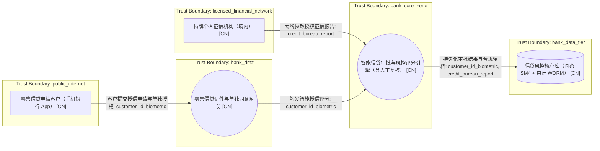

# 综合隐私、数据安全与 AI 影响评估报告（Unified DPIA / PIA / FRIA Report）

> **模板对标**：`TPL-DPIA-001` ｜ **评估编号**：`DPIA-20261122-BANK-RETAIL-AI-C` ｜ **生成时间**：`2026-11-22 15:46:32 UTC`
> **法定归档提示**：本报告及支撑证据须保存至少 **3 年**（重要数据及涉监管报送项目不少于 5 年）。

---

## 一、 评估基本档案（Executive Summary）

| 评估属性 | 评估内容 |
| :--- | :--- |
| **系统 / 功能名称** | 商业银行零售智能信贷审批与风控系统 (Banking AI Credit Underwriting) (`bank-retail-ai-credit`) |
| **数据控制者 / 处理者** | 示例商业银行股份有限公司（总行零售金融总部） |
| **业务负责人 (BO)** | 待填写 |
| **行业板块 / CIIO 标识** | `banking` ｜ CIIO：`是` |
| **适用法域** | PIPL, CN_DSL_NDSR, EU_AI_ACT |
| **触发评估类型** | DPIA/PIA：`强制触发` ｜ FRIA：`强制触发` ｜ 重要数据评估：`强制触发` |
| **DPO / 合规联络人** | `cco-privacy@example-bank.cn` |
| **固有最高风险 → 残余最高风险** | `HIGH (12)` → `MEDIUM (6)` |
| **CI/CD 门禁结论** | **WARN（警示放行）** (Exit Code: `0`) |
| **建议下次复评日期** | `2027-05-21` |

### 门禁决策说明
* 残余最高风险为 MEDIUM，允许警示放行，请在 14 个工作日内闭环缓解计划。

---

## 二、 架构数据流图与处理活动记录（DFD & RoPA）

### 2.1 数据流向图（Mermaid DFD）

### 2.2 数据分类分级与敏感资产清单

| 资产 ID | 资产名称 | 数据类别 | 分类分级 (GB/T 43697) | 金融分级 (JR/T 0197) | 可识别度 | GDPR 特殊 | PIPL 敏感 |
| :--- | :--- | :--- | :---: | :---: | :---: | :---: | :---: |
| `customer_id_biometric` | 客户身份核验与活体特征摘要 | basic_identity, government_id, biometric | `important` | L4 | `pseudonymized` | 是 | 是 |
| `credit_bureau_report` | 个人征信与金融账户流水画像 | financial_account | `important` | L4 | `directly_identifiable` | 否 | 是 |

### 2.3 处理活动记录草案（RoPA 摘要）

| 处理节点 | 处理目的 | 合法性基础 | 涉及主体 | 第三方接收方 / 跨境路径 | 留存期限 | 已生效控制 |
| :--- | :--- | :--- | :--- | :--- | :--- | :--- |
| 零售信贷进件与单独同意网关 (`credit_intake_gateway`) | 客户身份核验（KYC）与征信查询单独授权存证 | `separate_consent` | customers | 无 | 未关联存储 | [PC-ENC-03] pseudonymization (verified) |
| 智能信贷审批与风控评分引擎（含人工复核） (`ai_underwriting_engine`) | 零售贷款额度测算与反欺诈风控审批 | `separate_consent` | customers | 无 | 信贷风控核心库（国密 SM4 + 审计 WORM）: 1825 days | [PC-ENC-03] pseudonymization (verified); [PC-AI-01] human_in_the_loop (verified); [PC-DAT-01] data_minimization (verified) |

---

## 三、 法定红线校验与多法域强制评估触发判定

### 3.1 法定红线（Zero-Tolerance）校验结果
* [x] 未命中任何法定红线（`RL-01` 至 `RL-05`）

### 3.2 法定触发阈值判定明细

| 法域 | 是否强制触发 | 判定摘要 | 命中的规则 ID 与涉及元素 |
| :--- | :---: | :--- | :--- |
| **PIPL** | 是 | 命中 3 项标准（阈值 ≥ 1），强制触发合规影响评估。 | `PIPL-ART55-01` (customer_id_biometric, credit_bureau_report); `PIPL-ART55-02` (ai_underwriting_engine); `PIPL-ART55-05` (ai_underwriting_engine) |
| **CN_DSL_NDSR** | 是 | 命中 2 项标准（阈值 ≥ 1），强制触发合规影响评估。 | `DSL-ART30-IMP` (customer_id_biometric, credit_bureau_report); `CSL-ART37-CIIO` (metadata.is_ciio) |
| **EU_AI_ACT** | 是 | 命中 1 项标准（阈值 ≥ 1），强制触发合规影响评估。 | `AIA-ART06-HRAI` (metadata.ai_system) |

---

## 四、 合法性、必要性与比例性实质审查（DPO 人工审查章节）

> **说明**：自动化引擎已完成客观事实核验与阈值判定，以下实质裁量由业务负责人起草并经 DPO 复核确认。

1. **合法性基础适格性论证**：<请确认所选合法性基础覆盖所有适用法域，且未在中国业务中误用 GDPR 合法利益>
2. **最小必要与比例性论证**：<请论证采集敏感字段/生物识别/金融数据的不可替代性及已评估的低侵入替代方案>
3. **数据主体权利保障机制**：<请说明告知、撤回同意、查询删除、关闭个性化与人工申诉的 SLA 与操作路径>

---

## 五、 专项影响评估（按需自动激活）

### 5.1 EU AI Act 基本权利影响评估（FRIA — Art. 27）
* **AI 风险定级与模型卡片**：`high_risk` / `docs/model_cards/retail_credit_llm_v3.md`
* **受影响群体与部署频次**：<请说明受影响的自然人群体范围、弱势群体排查与调用频次>
* **平等权与非歧视风险评估**：<请补充训练数据代表性、群体误拒率偏差测试结论>
* **人工监督落地措施（Art. 14）**：<请补充操作员复核 SOP 与一键中止 Kill-Switch 演练记录>

### 5.2 重要数据 / CIIO 安全评估（DSL Art. 30 / 网数条例 Art. 31）
* **国家安全与公共利益影响评估**：<请补充重要/核心数据共享与出境影响分析>
* **年度主管部门报送/出境评估回执编号**：<请填写备案或申报编号>

---

## 六、 LINDDUN 隐私威胁建模与量化风险矩阵

### 6.1 威胁评估与控制折减明细

* **发现总数**：`2`（Critical: `0` ｜ High: `0` ｜ Medium: `2` ｜ Low: `0`）

| 发现 ID | 节点 / 流 | LINDDUN 类别 | 固有风险 (L×S) | 已生效控制 | 残余风险 (L×S) | 计划项 / 推荐 PETs |
| :--- | :--- | :--- | :---: | :--- | :---: | :--- |
| `LIND-I-credit_intake_gateway` | 零售信贷进件与单独同意网关 (`credit_intake_gateway`) | `identifiability` | `HIGH` (3×4=12) | mit_pseudo_bio | **`MEDIUM`** (2×3=6) | 计划: 无；推荐: data_minimization, data_masking, encryption_at_rest, pseudonymization |
| `LIND-L-ai_underwriting_engine` | 智能信贷审批与风控评分引擎（含人工复核） (`ai_underwriting_engine`) | `linkability` | `HIGH` (3×4=12) | mit_pseudo_bio, mit_minimization_engine | **`MEDIUM`** (2×3=6) | 计划: 无；推荐: data_minimization, retention_enforcement, pseudonymization, anonymization |

### 6.2 整改追踪与行动计划（Remediation Plan）

| 整改编号 | 关联发现 ID | 对应控制编号 | 具体整改动作 | 责任人 | 目标完成日 | 验证证据链接 | 状态 |
| :--- | :--- | :---: | :--- | :--- | :---: | :--- | :---: |
| `REM-01` | `LIND-I-credit_intake_gateway` | `PC-DAT-01` | 针对 零售信贷进件与单独同意网关（生物识别或 AI 训练带来的直接身份重识别风险）落实缓解控制并补充审计证据 | 待指派 | `2026-12-22` | - | `Open` |
| `REM-02` | `LIND-L-ai_underwriting_engine` | `PC-DAT-01` | 针对 智能信贷审批与风控评分引擎（含人工复核）（跨数据集关联画像导致高可链接性风险）落实缓解控制并补充审计证据 | 待指派 | `2026-12-22` | - | `Open` |

---

## 七、 最终合规意见与签批页（Sign-Off）

| 角色 | 姓名 / 部门 | 审批结论 | 意见与附带条件 | 日期 |
| :--- | :--- | :--- | :--- | :---: |
| **业务负责人 (BO)** |  | 待确认 |  |  |
| **隐私工程 / 安全 (2LoD)** |  | 待技术验证 |  |  |
| **数据保护官 (DPO)** | 法律合规部 / 首席合规官办公室 | 已签批 | COMP-PIA-2026-088 | 2026-11-15 |
