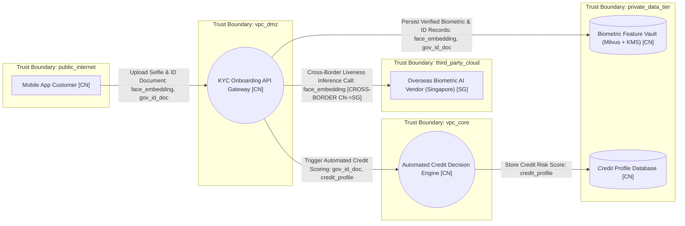

# 综合隐私、数据安全与 AI 影响评估报告（Unified DPIA / PIA / FRIA Report）

> **模板对标**：`TPL-DPIA-001` ｜ **评估编号**：`DPIA-20261122-CROSS-BORDER-FAC` ｜ **生成时间**：`2026-11-22 15:46:31 UTC`
> **法定归档提示**：本报告及支撑证据须保存至少 **3 年**（重要数据及涉监管报送项目不少于 5 年）。

---

## 一、 评估基本档案（Executive Summary）

| 评估属性 | 评估内容 |
| :--- | :--- |
| **系统 / 功能名称** | Cross-Border AI Facial Recognition KYC & Credit Scoring (`cross-border-face-kyc`) |
| **数据控制者 / 处理者** | FinTech Cloud Holdings Ltd. |
| **业务负责人 (BO)** | 待填写 |
| **行业板块 / CIIO 标识** | `general` ｜ CIIO：`否` |
| **适用法域** | GDPR, PIPL |
| **触发评估类型** | DPIA/PIA：`强制触发` ｜ FRIA：`未触发` ｜ 重要数据评估：`未触发` |
| **DPO / 合规联络人** | `dpo@fintech-example.com` |
| **固有最高风险 → 残余最高风险** | `CRITICAL (16)` → `CRITICAL (16)` |
| **CI/CD 门禁结论** | **BLOCK（阻断合并）** (Exit Code: `1`) |
| **建议下次复评日期** | `2027-02-20` |

### 门禁决策说明
* [红线阻断 RL-03] Unlawful Cross-Border Transfer of Important, CIIO, or Personal Data：跨境流 'flow_kyc_to_sg_ai' 未配置任何法定跨境机制（transfer_mechanism=none）。
* [红线阻断 RL-05] High-Impact Fully Automated Decision-Making Without Human Oversight：处理节点 ['risk_scoring_engine'] 执行涉重大权益/拒绝服务的纯自动化决策，但未提供人工复核与申诉机制（human_review_available=false）。
* 存在 5 项未豁免的高/极高残余风险：LIND-I-kyc_gateway(high:12), LIND-L-risk_scoring_engine(high:9), LIND-U-risk_scoring_engine(high:12), LIND-NC-credit_profile_db(high:9), LIND-NC-flow_kyc_to_sg_ai(critical:16)。
* 系统固有风险达到 CRITICAL，按治理政策首次上线必须完成 DPO 人工复核签批（dpo_signoff.approved=true）。

---

## 二、 架构数据流图与处理活动记录（DFD & RoPA）

### 2.1 数据流向图（Mermaid DFD）

### 2.2 数据分类分级与敏感资产清单

| 资产 ID | 资产名称 | 数据类别 | 分类分级 (GB/T 43697) | 金融分级 (JR/T 0197) | 可识别度 | GDPR 特殊 | PIPL 敏感 |
| :--- | :--- | :--- | :---: | :---: | :---: | :---: | :---: |
| `face_embedding` | Facial Biometric Template & Selfie Image | biometric | `general` | - | `directly_identifiable` | 是 | 是 |
| `gov_id_doc` | National ID & Passport Scan | basic_identity, government_id | `general` | - | `directly_identifiable` | 否 | 是 |
| `credit_profile` | Automated Credit Risk Score | financial_account, online_behavior | `general` | - | `pseudonymized` | 否 | 是 |

### 2.3 处理活动记录草案（RoPA 摘要）

| 处理节点 | 处理目的 | 合法性基础 | 涉及主体 | 第三方接收方 / 跨境路径 | 留存期限 | 已生效控制 |
| :--- | :--- | :--- | :--- | :--- | :--- | :--- |
| KYC Onboarding API Gateway (`kyc_gateway`) | Identity verification and anti-fraud compliance | `separate_consent` | customers | Overseas Biometric AI Vendor (Singapore) (processor, SG); flow_kyc_to_sg_ai (CN -> SG, mechanism=none) | Biometric Feature Vault (Milvus + KMS): 180 days | encryption_in_transit (implemented) |
| Automated Credit Decision Engine (`risk_scoring_engine`) | Automated loan eligibility and credit limit determination | `contract` | customers | 无 | Credit Profile Database: indefinite (unspecified) | encryption_in_transit (implemented) |

---

## 三、 法定红线校验与多法域强制评估触发判定

### 3.1 法定红线（Zero-Tolerance）校验结果
* [x] **命中法定红线（强制阻断、禁止豁免）**：
  * **`RL-03` (`UNLAWFUL-CROSS-BORDER`) — Unlawful Cross-Border Transfer of Important, CIIO, or Personal Data**：跨境流 'flow_kyc_to_sg_ai' 未配置任何法定跨境机制（transfer_mechanism=none）。（依据：`CSL Art. 37; DSL Art. 31; PIPL Art. 38-40; NDSR Art. 35-39; GDPR Chapter V (Art. 44-49)`，涉及元素：`flow_kyc_to_sg_ai`）
  * **`RL-05` (`UNCHECKED-AUTOMATED-DECISION`) — High-Impact Fully Automated Decision-Making Without Human Oversight**：处理节点 ['risk_scoring_engine'] 执行涉重大权益/拒绝服务的纯自动化决策，但未提供人工复核与申诉机制（human_review_available=false）。（依据：`GDPR Art. 22; PIPL Art. 24; EU AI Act Art. 14`，涉及元素：`risk_scoring_engine`）

### 3.2 法定触发阈值判定明细

| 法域 | 是否强制触发 | 判定摘要 | 命中的规则 ID 与涉及元素 |
| :--- | :---: | :--- | :--- |
| **GDPR** | 是 | 命中 7 项标准（阈值 ≥ 2），强制触发合规影响评估。 | `GDPR-WP29-01` (risk_scoring_engine); `GDPR-WP29-02` (risk_scoring_engine); `GDPR-WP29-04` (face_embedding); `GDPR-WP29-05` (metadata.scale); `GDPR-WP29-06` (risk_scoring_engine); `GDPR-WP29-08` (kyc_gateway, risk_scoring_engine); `GDPR-WP29-09` (risk_scoring_engine) |
| **PIPL** | 是 | 命中 5 项标准（阈值 ≥ 1），强制触发合规影响评估。 | `PIPL-ART55-01` (face_embedding, gov_id_doc, credit_profile); `PIPL-ART55-02` (risk_scoring_engine); `PIPL-ART55-03` (flow_kyc_to_sg_ai); `PIPL-ART55-04` (flow_kyc_to_sg_ai); `PIPL-ART55-05` (risk_scoring_engine) |

### 3.3 跨法域合规冲突提示
* [CONFLICT-SENSITIVE-SCOPE] 资产 ['gov_id_doc', 'credit_profile'] 在 GDPR Art. 9 中非特殊类别，但在中国 PIPL 第 28 条下属于敏感个人信息（须单独同意并触发强制 PIA）。

---

## 四、 合法性、必要性与比例性实质审查（DPO 人工审查章节）

> **说明**：自动化引擎已完成客观事实核验与阈值判定，以下实质裁量由业务负责人起草并经 DPO 复核确认。

1. **合法性基础适格性论证**：<请确认所选合法性基础覆盖所有适用法域，且未在中国业务中误用 GDPR 合法利益>
2. **最小必要与比例性论证**：<请论证采集敏感字段/生物识别/金融数据的不可替代性及已评估的低侵入替代方案>
3. **数据主体权利保障机制**：<请说明告知、撤回同意、查询删除、关闭个性化与人工申诉的 SLA 与操作路径>

---

## 六、 LINDDUN 隐私威胁建模与量化风险矩阵

### 6.1 威胁评估与控制折减明细

* **发现总数**：`7`（Critical: `1` ｜ High: `4` ｜ Medium: `2` ｜ Low: `0`）

| 发现 ID | 节点 / 流 | LINDDUN 类别 | 固有风险 (L×S) | 已生效控制 | 残余风险 (L×S) | 计划项 / 推荐 PETs |
| :--- | :--- | :--- | :---: | :--- | :---: | :--- |
| `LIND-U-mobile_user` | Mobile App Customer (`mobile_user`) | `unawareness` | `MEDIUM` (2×4=8) | 无 | **`MEDIUM`** (2×4=8) | 计划: 无；推荐: consent_management, privacy_notice_transparency, human_in_the_loop |
| `LIND-I-kyc_gateway` | KYC Onboarding API Gateway (`kyc_gateway`) | `identifiability` | `HIGH` (3×4=12) | 无 | **`HIGH`** (3×4=12) | 计划: 无；推荐: data_minimization, data_masking, encryption_at_rest, pseudonymization |
| `LIND-L-risk_scoring_engine` | Automated Credit Decision Engine (`risk_scoring_engine`) | `linkability` | `HIGH` (3×3=9) | 无 | **`HIGH`** (3×3=9) | 计划: 无；推荐: data_minimization, retention_enforcement, pseudonymization, anonymization |
| `LIND-U-risk_scoring_engine` | Automated Credit Decision Engine (`risk_scoring_engine`) | `unawareness` | `HIGH` (4×3=12) | 无 | **`HIGH`** (4×3=12) | 计划: mit_human_review_roadmap；推荐: consent_management, privacy_notice_transparency, human_in_the_loop |
| `LIND-D-credit_profile_db` | Credit Profile Database (`credit_profile_db`) | `disclosure` | `HIGH` (3×3=9) | mit_tls_global | **`MEDIUM`** (2×3=6) | 计划: 无；推荐: data_minimization, purpose_limitation, data_masking, encryption_in_transit |
| `LIND-NC-credit_profile_db` | Credit Profile Database (`credit_profile_db`) | `non_compliance` | `HIGH` (3×3=9) | 无 | **`HIGH`** (3×3=9) | 计划: 无；推荐: purpose_limitation, consent_management, audit_logging, security_audit |
| `LIND-NC-flow_kyc_to_sg_ai` | Cross-Border Liveness Inference Call (`flow_kyc_to_sg_ai`) | `non_compliance` | `CRITICAL` (4×4=16) | 无 | **`CRITICAL`** (4×4=16) | 计划: 无；推荐: purpose_limitation, consent_management, audit_logging, security_audit |

### 6.2 整改追踪与行动计划（Remediation Plan）

| 整改编号 | 关联发现 ID | 对应控制编号 | 具体整改动作 | 责任人 | 目标完成日 | 验证证据链接 | 状态 |
| :--- | :--- | :---: | :--- | :--- | :---: | :--- | :---: |
| `REM-01` | `LIND-U-mobile_user` | `PC-GOV-02` | 针对 Mobile App Customer（数据主体知情权或干预权不足）落实缓解控制并补充审计证据 | 待指派 | `2026-12-22` | - | `Open` |
| `REM-02` | `LIND-I-kyc_gateway` | `PC-DAT-01` | 针对 KYC Onboarding API Gateway（生物识别或 AI 训练带来的直接身份重识别风险）落实缓解控制并补充审计证据 | 待指派 | `2026-12-06` | - | `Open` |
| `REM-03` | `LIND-L-risk_scoring_engine` | `PC-DAT-01` | 针对 Automated Credit Decision Engine（跨数据集关联画像导致高可链接性风险）落实缓解控制并补充审计证据 | 待指派 | `2026-12-06` | - | `Open` |
| `REM-04` | `LIND-U-risk_scoring_engine` | `PC-GOV-02` | 针对 Automated Credit Decision Engine（自动化决策缺失人工介入与可干预通道）落实缓解控制并补充审计证据 | 待指派 | `2026-12-06` | - | `Open` |
| `REM-05` | `LIND-D-credit_profile_db` | `PC-DAT-01` | 针对 Credit Profile Database（数据存储安全防护缺陷导致信息泄露风险）落实缓解控制并补充审计证据 | 待指派 | `2026-12-22` | - | `Open` |
| `REM-06` | `LIND-NC-credit_profile_db` | `PC-GOV-01` | 针对 Credit Profile Database（数据存储未设定留存期限上限（无限期留存））落实缓解控制并补充审计证据 | 待指派 | `2026-12-06` | - | `Open` |
| `REM-07` | `LIND-NC-flow_kyc_to_sg_ai` | `PC-GOV-01` | 针对 Cross-Border Liveness Inference Call（跨境数据流缺失法定传输合规机制）落实缓解控制并补充审计证据 | 待指派 | `2026-12-06` | - | `Open` |

---

## 七、 最终合规意见与签批页（Sign-Off）

| 角色 | 姓名 / 部门 | 审批结论 | 意见与附带条件 | 日期 |
| :--- | :--- | :--- | :--- | :---: |
| **业务负责人 (BO)** |  | 待确认 |  |  |
| **隐私工程 / 安全 (2LoD)** |  | 待技术验证 |  |  |
| **数据保护官 (DPO)** |  | 待审批 |  |  |
