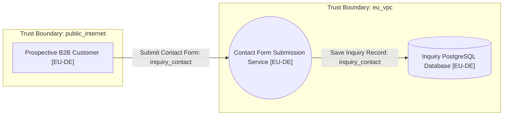

# 综合隐私、数据安全与 AI 影响评估报告（Unified DPIA / PIA / FRIA Report）

> **模板对标**：`TPL-DPIA-001` ｜ **评估编号**：`DPIA-20261122-CORP-MARKETING-S` ｜ **生成时间**：`2026-11-22 15:46:31 UTC`
> **法定归档提示**：本报告及支撑证据须保存至少 **3 年**（重要数据及涉监管报送项目不少于 5 年）。

---

## 一、 评估基本档案（Executive Summary）

| 评估属性 | 评估内容 |
| :--- | :--- |
| **系统 / 功能名称** | Corporate Marketing Website & Contact Form (`corp-marketing-site`) |
| **数据控制者 / 处理者** | Acme Software GmbH |
| **业务负责人 (BO)** | 待填写 |
| **行业板块 / CIIO 标识** | `general` ｜ CIIO：`否` |
| **适用法域** | GDPR, PIPL |
| **触发评估类型** | DPIA/PIA：`未触发` ｜ FRIA：`未触发` ｜ 重要数据评估：`未触发` |
| **DPO / 合规联络人** | `privacy@acme-example.eu` |
| **固有最高风险 → 残余最高风险** | `LOW (0)` → `LOW (0)` |
| **CI/CD 门禁结论** | **PASS（自动放行）** (Exit Code: `0`) |
| **建议下次复评日期** | `2027-11-22` |

### 门禁决策说明
* 未命中法定红线，残余风险处于可接受范围（LOW），门禁自动放行。

---

## 二、 架构数据流图与处理活动记录（DFD & RoPA）

### 2.1 数据流向图（Mermaid DFD）

### 2.2 数据分类分级与敏感资产清单

| 资产 ID | 资产名称 | 数据类别 | 分类分级 (GB/T 43697) | 金融分级 (JR/T 0197) | 可识别度 | GDPR 特殊 | PIPL 敏感 |
| :--- | :--- | :--- | :---: | :---: | :---: | :---: | :---: |
| `inquiry_contact` | Business Contact Inquiry | basic_identity, contact_info | `general` | - | `directly_identifiable` | 否 | 否 |

### 2.3 处理活动记录草案（RoPA 摘要）

| 处理节点 | 处理目的 | 合法性基础 | 涉及主体 | 第三方接收方 / 跨境路径 | 留存期限 | 已生效控制 |
| :--- | :--- | :--- | :--- | :--- | :--- | :--- |
| Contact Form Submission Service (`contact_api`) | Respond to inbound B2B product inquiries | `consent` | business_contacts | 无 | Inquiry PostgreSQL Database: 90 days | 无 |

---

## 三、 法定红线校验与多法域强制评估触发判定

### 3.1 法定红线（Zero-Tolerance）校验结果
* [x] 未命中任何法定红线（`RL-01` 至 `RL-05`）

### 3.2 法定触发阈值判定明细

| 法域 | 是否强制触发 | 判定摘要 | 命中的规则 ID 与涉及元素 |
| :--- | :---: | :--- | :--- |
| **GDPR** | 否 | 命中 0 项标准（低于强制阈值 2），无需强制评估。 | 无 |
| **PIPL** | 否 | 命中 0 项标准（低于强制阈值 1），无需强制评估。 | 无 |

---

## 四、 合法性、必要性与比例性实质审查（DPO 人工审查章节）

> **说明**：自动化引擎已完成客观事实核验与阈值判定，以下实质裁量由业务负责人起草并经 DPO 复核确认。

1. **合法性基础适格性论证**：<请确认所选合法性基础覆盖所有适用法域，且未在中国业务中误用 GDPR 合法利益>
2. **最小必要与比例性论证**：<请论证采集敏感字段/生物识别/金融数据的不可替代性及已评估的低侵入替代方案>
3. **数据主体权利保障机制**：<请说明告知、撤回同意、查询删除、关闭个性化与人工申诉的 SLA 与操作路径>

---

## 六、 LINDDUN 隐私威胁建模与量化风险矩阵

### 6.1 威胁评估与控制折减明细

* **发现总数**：`0`（Critical: `0` ｜ High: `0` ｜ Medium: `0` ｜ Low: `0`）

* 当前架构未检出需额外处置的 LINDDUN 隐私威胁。

---

## 七、 最终合规意见与签批页（Sign-Off）

| 角色 | 姓名 / 部门 | 审批结论 | 意见与附带条件 | 日期 |
| :--- | :--- | :--- | :--- | :---: |
| **业务负责人 (BO)** |  | 待确认 |  |  |
| **隐私工程 / 安全 (2LoD)** |  | 待技术验证 |  |  |
| **数据保护官 (DPO)** |  | 待审批 |  |  |
