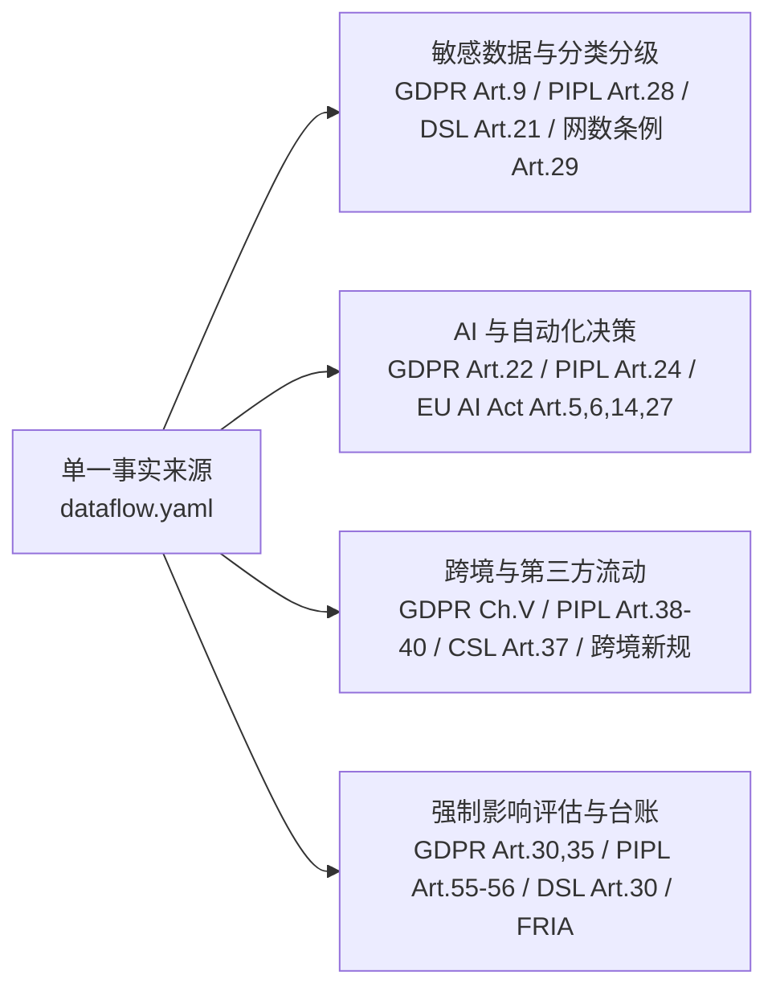

# 02. 多法域法规追溯矩阵（Regulatory Traceability Matrix, RTM）

| 文档属性 | 内容 |
| :--- | :--- |
| **文档编号** | `RTM-COMP-002` |
| **版本号** | `v1.0` |
| **核心作用** | 建立“外部法规条款 ↔ 内部规则 ID (`rules/`) ↔ 架构观测字段 (`dataflow.yaml`) ↔ 控制编号 (`PC-xxx`) ↔ 审计证据”的端到端追溯链 |
| **覆盖法域** | 欧盟（GDPR + EU AI Act）、中国（“三法两条例” + 跨境新规 + GB/T 39335 / 43697）、国际通用标准（ISO/IEC 27701 / NIST PF） |

---

## 一、 跨法域合规协同视图（Assess Once, Comply Many）

同一业务架构变更往往同时触及多部法规。本矩阵将分散在不同法律中的重复要求收敛为统一的治理检查点，避免多头评估：

---

## 二、 欧盟法规追溯矩阵：GDPR & WP29/EDPB 指南

### 2.1 GDPR 核心条款映射

| 规则 ID | 法规条款 | 治理与合规核心要求 | `dataflow.yaml` 观测字段 | 关联控制编号 | 审计留痕证据 |
| :--- | :--- | :--- | :--- | :--- | :--- |
| `GDPR-ART06-LB` | GDPR Art. 6 | 每项个人数据处理活动必须具备明确且有效的合法性基础 | `processes[].lawful_basis` | `PC-GOV-01` | 隐私政策合法性基础表、用户同意日志 |
| `GDPR-ART09-SP` | GDPR Art. 9 & 10 | 禁止处理特殊类别数据（生物识别、健康、基因、宗教/政治、性取向、犯罪记录），除非满足例外条件 | `data_assets[].categories` | `PC-GOV-02`, `PC-ENC-02` | 明确同意记录、Art. 9(2) 例外法律意见书 |
| `GDPR-ART22-ADM` | GDPR Art. 22 | 对个人产生法律或类似重大影响的纯自动化决策须保障人工干预、申诉与解释权 | `processes[].operations` (`automated_decision_making`), `prevents_rights_or_service`, `human_review_available` | `PC-AI-01`, `PC-AI-02` | 人工复核工单流程、申诉界面截图、算法说明文档 |
| `GDPR-ART25-PBD` | GDPR Art. 25 | 设计与默认隐私保护（数据最小化、假名化、留存期限限制） | `data_assets[].identifiability`, `stores[].retention_days`, `mitigations[]` | `PC-DAT-01`, `PC-ENC-03`, `PC-DAT-03` | 架构评审记录、自动过期清理任务配置 |
| `GDPR-ART30-ROPA` | GDPR Art. 30 | 控制者须持续维护处理活动记录（RoPA），含目的、主体、类别、接收方、跨境、留存期、安全措施 | `metadata`, `processes[]`, `stores[]`, `flows[]` | `PC-GOV-04` | 自动生成的 RoPA 台账及版本归档 |
| `GDPR-ART32-SEC` | GDPR Art. 32 | 与风险相称的技术与组织安全措施（传输/静态加密、访问控制、可审计性） | `flows[].encrypted_in_transit`, `stores[].encrypted_at_rest`, `access_control`, `audit_logging` | `PC-ENC-01`, `PC-ENC-02`, `PC-ACC-01` | KMS 配置、TLS/mTLS 策略、RBAC 权限清单 |
| `GDPR-ART36-CON` | GDPR Art. 36 | 若采取缓解措施后残余风险仍处于极高水平，上线前须向监管机构（SA）发起事前咨询 | 残余风险 `CRITICAL` 且无法进一步降级 | `PC-GOV-05` | DPO 升级意见书、监管咨询递交回执 |
| `GDPR-CH5-XBD` | GDPR Art. 44–49 | 向 EEA 境外传输个人数据须具备充分性认定、SCC、BCR 等法定传输机制及 TIA 评估 | 跨境流 `flows[].transfer_mechanism` | `PC-XBD-01`, `PC-XBD-03` | 签署版 SCC 协议、Transfer Impact Assessment (TIA) |

### 2.2 GDPR Art. 35 强制 DPIA 触发规则（WP29 / EDPB 9 项标准）

> **判定规则（WP248 rev.01）**：命中以下 **≥ 2 项标准** 原则上强制触发 DPIA；在涉及大规模特殊数据或系统性公开监控等极端情形下，命中 1 项亦建议启动评估。

| 规则 ID | WP29 标准名称 | 引擎判定逻辑（对应 `dataflow.yaml`） |
| :--- | :--- | :--- |
| `GDPR-WP29-01` | 评估或打分（Evaluation / Scoring） | 任一 Process 包含 `profiling` 或 `scoring` 操作 |
| `GDPR-WP29-02` | 具有法律或重大影响的自动化决策 | Process 包含 `automated_decision_making` 且 `prevents_rights_or_service == true` |
| `GDPR-WP29-03` | 系统性监控（Systematic Monitoring） | Process 包含 `systematic_monitoring` 操作 |
| `GDPR-WP29-04` | 敏感数据或高度个人化数据 | 任一 Asset 属于 `GDPR_SPECIAL_CATEGORIES` 或 `is_sensitive_override == true` |
| `GDPR-WP29-05` | 大规模处理（Large Scale） | `metadata.scale == "large"`（默认 `estimated_subjects >= 100,000`） |
| `GDPR-WP29-06` | 数据集匹配或融合（Matching / Combining） | Process 包含 `dataset_matching` 操作 |
| `GDPR-WP29-07` | 涉及弱势数据主体（Vulnerable Data Subjects） | `metadata.data_subjects` 含 `minors` / `employees` / `patients` / `elderly` / `vulnerable_groups` |
| `GDPR-WP29-08` | 创新性技术或组织方案应用 | Process 标记 `innovative_technology == true` 或包含 `ai_training` / `biometric_identification` |
| `GDPR-WP29-09` | 阻止主体行使权利或使用服务/合同 | Process 标记 `prevents_rights_or_service == true` |

---

## 三、 欧盟人工智能法案追溯矩阵：EU AI Act (EU 2024/1689)

> **GRC 融合思考**：当业务系统引入 AI/ML 推理或生物识别/信用打分模型时，GDPR DPIA 关注“个人数据保护”，而 EU AI Act 关注“AI 系统安全性、非歧视与基本权利保护”。本体系将二者打通，避免 AI 合规与隐私合规割裂。

| 规则 ID | EU AI Act 条款 | 风险分级与合规要求 | `dataflow.yaml` 观测字段 | 门禁与控制映射 | 审计留痕证据 |
| :--- | :--- | :--- | :--- | :--- | :--- |
| `AIA-ART05-PROH` | Art. 5 | **禁止类 AI 实践（红线 `RL-01`）**：社会评分、无差别抓取人脸建库、职场/教育情绪识别、潜意识操纵、基于生物特征推断敏感属性 | `ai_system.prohibited_practices`（待模型扩展） | **Hard Block（不可豁免）** | 法务红线排除声明 |
| `AIA-ART06-HRAI` | Art. 6 & Annex III | **高风险 AI 判定**：远程生物识别/分类、信用评分与信贷资格评估、招聘与人事考核、关键基础设施、教育/执法/基本公共服务准入 | `ai_system.risk_tier == "high_risk"` 或 Process 命中 `biometric_identification` / `scoring` + `prevents_rights_or_service` | 触发 **高风险 AI 控制集 + FRIA** | 高风险 AI 分类定级备忘录 |
| `AIA-ART09-RMS` | Art. 9 | **AI 风险管理体系**：全生命周期持续识别、评估、测试并缓解可预见的 AI 风险与滥用风险 | 评估报告生命周期状态与测试记录 | `PC-AI-03` | AI 风险登记册、红队/对抗测试报告 |
| `AIA-ART10-DATA` | Art. 10 | **训练/验证/测试数据治理**：数据来源合法性、代表性、偏差（Bias）检测与缓解 | `processes[].operations` (`ai_training`), `data_assets[]` | `PC-AI-04`, `PC-DAT-01` | 数据集卡片（Data Card）、偏差评估报告 |
| `AIA-ART13-TRNS` | Art. 13 & Art. 50 | **透明度与告知义务**：向部署者提供技术说明书；向自然人明确告知正在与 AI 交互或内容为 AI 生成 | `entities[].notice_provided`, `ai_system.transparency_notice` | `PC-GOV-03`, `PC-AI-02` | 模型卡片（Model Card）、AI 交互告知截图 |
| `AIA-ART14-HOV` | Art. 14 | **有效人工监督（Human Oversight）**：防止自动化偏见，确保操作员能理解、干预或一键中止 AI 输出 | `processes[].human_review_available` | `PC-AI-01` | 人工接管 SOP、Kill-Switch 演练记录 |
| `AIA-ART27-FRIA` | Art. 27 | **基本权利影响评估（FRIA）**：部署高风险 AI（尤其金融信贷、保险、公共服务等领域）前，评估对平等权、非歧视权、隐私权的影响，并可与 GDPR DPIA 合并实施 | 高风险 AI 触发标志 | 联动 **综合影响评估报告（DPIA+FRIA）** | 经签批的 FRIA 章节及监管通知留存（如适用） |

---

## 四、 中国“三法两条例”及核心配套规章追溯矩阵

### 4.1 三法：《网络安全法》(CSL)、《数据安全法》(DSL)、《个人信息保护法》(PIPL)

| 规则 ID | 法律条款 | 治理与合规核心要求 | `dataflow.yaml` 观测字段 | 关联控制编号 | 审计留痕证据 |
| :--- | :--- | :--- | :--- | :--- | :--- |
| `CSL-ART21-MLPS` | **网安法** 第 21 条 | 落实网络安全等级保护制度（等保 2.0），实施访问控制、日志留存不少于 6 个月、数据分类与加密备份 | `stores[].encrypted_at_rest`, `access_control`, `audit_logging` | `PC-ACC-01`, `PC-ACC-02`, `PC-ENC-02` | 等保定级备案证明、测评报告、6 个月日志留存配置 |
| `CSL-ART37-CIIO` | **网安法** 第 37 条 | 关键信息基础设施运营者（CIIO）在境内收集产生的个人信息和重要数据须境内存储；确需出境的必须通过网信部门安全评估 | `metadata.is_ciio`, 跨境流 `transfer_mechanism` | `PC-XBD-02` | 网信办数据出境安全评估通过批复 |
| `DSL-ART21-CLS` | **数安法** 第 21 条 | 建立数据分类分级保护制度，识别一般数据、重要数据、核心数据并实施差异化保护 | `data_assets[].data_classification`（对标 GB/T 43697） | `PC-DAT-02` | 数据分类分级目录、重要数据识别清单 |
| `DSL-ART30-IMP` | **数安法** 第 30 条 | 重要数据处理者须定期开展风险评估并向有关主管部门报送风险评估报告 | `data_assets[]` 含 `important_data` / `core_data` | `PC-GOV-06` | 重要数据年度风险评估报告与报送回执 |
| `DSL-ART31-XBD` | **数安法** 第 31 条 | 重要数据出境必须通过网信办数据出境安全评估（红线 `RL-03`） | 重要数据跨境流 `transfer_mechanism == pipl_security_assessment` | `PC-XBD-02` | 网信办重要数据出境安全评估申报材料与批复 |
| `PIPL-ART13-LB` | **个保法** 第 13 条 | 处理个人信息须具备法定 7 项合法性基础之一（**注意：中国个保法无 GDPR“合法利益”条款**） | `processes[].lawful_basis`（命中 `legitimate_interests` 在 PIPL 下报错！） | `PC-GOV-01` | 隐私政策、用户授权同意流水 |
| `PIPL-ART24-ADM` | **个保法** 第 24 条 | 自动化决策须保证透明与结果公平公正，禁止大数据杀熟；提供不针对个人特征的选项或便捷拒绝方式；重大影响须提供说明并允许拒绝仅通过自动化作出决定 | `processes[].operations` (`profiling`/`automated_decision_making`), `entities[].opt_out_available`, `human_review_available` | `PC-AI-01`, `PC-AI-02` | 关闭个性化推荐开关截图、人工申诉渠道证明 |
| `PIPL-ART28-SEN` | **个保法** 第 28–31 条 | 处理敏感个人信息（含生物识别、金融账户、行踪轨迹、医疗健康、不满 14 周岁未成年人等）须具特定目的与充分必要性、采取严格保护措施并取得**单独同意**（未满 14 周岁须监护人同意） | `data_assets[].categories` ∈ `PIPL_SENSITIVE_CATEGORIES`, `lawful_basis == separate_consent` | `PC-GOV-02`, `PC-ENC-02` | 单独同意弹窗交互录屏、未成年人监护人核验记录 |
| `PIPL-ART38-XBD` | **个保法** 第 38–40 条 & **2024 跨境新规** | 境内个人数据出境须依据体量与敏感度落实安全评估（≥100 万一般或 ≥1 万敏感）/ 标准合同备案（10万–100万一般或 <1万敏感）/ 认证，或满足跨境新规明确豁免情形，并取得单独同意 | 跨境流 `transfer_mechanism`, `metadata.estimated_subjects`, 数据敏感度 | `PC-XBD-01`, `PC-XBD-02`, `PC-XBD-03` | 境外接收方标准合同备案回执 / 安全评估批复 / 豁免法律评估单 |
| `PIPL-ART55-01..05` | **个保法** 第 55 条 | **强制 PIA 触发五类法定情形**（命中任意 1 项即触发）： ① 处理敏感个人信息 (`PIPL-ART55-01`) ② 利用个人信息进行自动化决策 (`PIPL-ART55-02`) ③ 委托处理、向其他处理者提供、公开个人信息 (`PIPL-ART55-03`) ④ 向境外提供个人信息 (`PIPL-ART55-04`) ⑤ 其他对个人权益有重大影响的 (`PIPL-ART55-05`) | 资产敏感性、自动化决策操作、第三方流/`public_disclosure`、跨境流、`prevents_rights_or_service` | 触发 **PIPL PIA + GB/T 39335 评估** | 经 DPO 签批的 PIA 评估报告 |
| `PIPL-ART56-RET` | **个保法** 第 56 条 | PIA 报告和处理情况记录应当**至少保存三年** | 归档机制与报告元数据 | `PC-GOV-04` | 不可篡改归档库（保留期 ≥ 1095 天） |

### 4.2 两条例：《关键信息基础设施安全保护条例》 & 《网络数据安全管理条例》（国务院令第 790 号）

| 规则 ID | 条例条款 | 治理与合规核心要求 | `dataflow.yaml` 观测字段 | 关联控制编号 | 审计留痕证据 |
| :--- | :--- | :--- | :--- | :--- | :--- |
| `CIIO-ART17-CHG` | **CIIO 条例** 第 17/19 条 | CIIO 须每年至少开展一次安全检测与风险评估；发生重大架构变更或采购可能影响国家安全的网络产品/服务时须提前开展安全评估/网络安全审查 | `metadata.is_ciio`, PR 架构 Diff 变更 | `PC-GOV-06`, `PC-XBD-03` | CIIO 年度测评报告、重大变更安全评估记录 |
| `NDSR-ART28-10M` | **网数条例** 第 28 条 | 处理 **1000 万人以上** 个人信息的网络数据处理者，须参照重要数据处理者履行责任人指定、机构设立及高标准安全保护义务 | `metadata.estimated_subjects >= 10_000_000` | `PC-GOV-06` | 数据安全负责人任命书、管理机构章程 |
| `NDSR-ART29-IMP` | **网数条例** 第 29 条 | 须参照行业目录与 **GB/T 43697** 识别申报重要数据，并在重要数据提供、委托处理或共同处理前开展风险评估 | `data_assets[].data_classification == "important"` + 第三方/共享流 | `PC-DAT-02`, `PC-XBD-03` | 重要数据申报记录、共享前风险评估报告 |
| `NDSR-ART31-ANN` | **网数条例** 第 31 条 | 重要数据处理者每年须对网络数据处理活动开展风险评估，并向省级以上有关主管部门报送 | 重要数据年度重评周期（365 天） | `PC-GOV-06` | 年度风险评估报告及主管部门报送凭证 |
| `NDSR-ART35-XBD` | **网数条例** 第 35–39 条 | 与《促进和规范数据跨境流动规定》衔接：明确豁免情形（如订立履行个人合同必需、跨境人力资源管理、紧急情况）与不得超出申报目的/范围出境的要求 | 跨境流 `transfer_mechanism`、`purposes` 一致性 | `PC-XBD-01`, `PC-XBD-02` | 出境合规路径自评表、出境数据流量审计日志 |
| `NDSR-AI-GEN` | **网数条例** 自动化采集与生成式 AI 衔接 | 使用自动化工具采集数据不得违法侵入或干扰正常服务；提供生成式 AI 服务须加强训练数据与生成内容安全管理 | `processes[].operations` (`ai_training`) | `PC-AI-03`, `PC-AI-04` | 训练语料合法来源证明、算法/大模型备案号 |

---

## 五、 国际通用 GRC 标准交叉对齐（ISO/IEC 27701 & NIST Privacy Framework）

便于本治理体系直接服务于 ISO 27701 认证审计或外企/跨国集团隐私合规汇报：

| 本体系控制域 | ISO/IEC 27701:2019 (PIMS) 对应条款 | NIST Privacy Framework 对应功能域 |
| :--- | :--- | :--- |
| `PC-GOV` 治理、合法性与透明 | 7.2 收集与处理条件、7.3 对 PII 主体的义务、5.2 领导作用 | `GV-P` (Govern-P) & `CM-P` (Communicate-P) |
| `PC-DAT` 数据分类分级与最小化 | 7.4 设计与默认隐私保护（7.4.1–7.4.9） | `ID-P` (Identify-P) & `CT-P` (Control-P) |
| `PC-ENC` 加密与匿名化 PETs | 7.4.5 去标识化、6.7 密码学控制 | `PR-P` (Protect-P) & `CT-P.DM` |
| `PC-ACC` 访问控制与审计追溯 | 6.6 访问控制、6.9.4 日志与监控 | `PR-P.AC` & `PR-P.PT` |
| `PC-AI` 算法与自动化决策治理 | 7.2.5 隐私影响评估、扩展对齐 ISO/IEC 42001 (AIMS) | `ID.RA-P` (Risk Assessment) & `CT-P` |
| `PC-XBD` 跨境与供应链第三方治理 | 7.5 PII 共享、传输与披露（7.5.1–7.5.4）、7.2.6 合同约束 | `ID.DE-P` (Ecosystem) & `GV.MT-P` |

---

## 六、 GRC 特别设计亮点：跨法域冲突校验

本矩阵特别识别了多法域并行时的**法条差异与冲突点**，并将在引擎规则包中显式校验，避免“拿欧美模板套中国合规”或反向误判：

1. **合法性基础冲突**：`legitimate_interests`（合法利益）在 GDPR Art. 6(1)(f) 下有效，但在中国 PIPL 第 13 条下**不存在该合法性基础**。若一个系统同时声明 `jurisdictions: [GDPR, PIPL]` 且某处理节点使用了 `legitimate_interests`，引擎将直接抛出跨法域合规告警。
2. **敏感数据口径差异**：`financial_account`（金融账户）、`precise_location`（行踪轨迹）与 `government_id`（身份证件）在中国 PIPL 第 28 条下明确属于**敏感个人信息**（直接触发强制 PIA 与单独同意），而在 GDPR Art. 9 文本中并非法定特殊类别数据。引擎按法域分别精准计算，不混为一谈。
3. **未成年人年龄线差异**：PIPL 第 28/31 条以 **14 周岁**为敏感个人信息及监护人同意红线；GDPR Art. 8 基准为 **16 周岁**（成员国可下调至 13 岁）。
4. **体量阈值阶梯差异**：GDPR WP29 对“大规模”采用定性+定量综合判断（本体系默认 10 万人基准）；中国网信办跨境新规与《网络数据安全管理条例》则存在 **1 万（敏感出境）/ 10 万（一般出境标准合同）/ 100 万（一般出境安全评估）/ 1000 万（参照重要数据保护义务）** 四级法定硬性人数阶梯。
