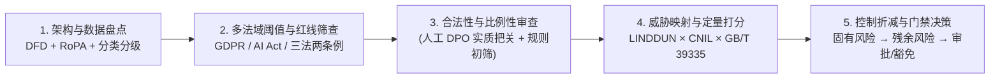

# 03. 整合式影响评估方法论（Unified Impact Assessment Methodology）

| 文档属性 | 内容 |
| :--- | :--- |
| **文档编号** | `METH-PRIV-003` |
| **版本号** | `v1.0` |
| **方法论融合** | **LINDDUN** 隐私威胁建模 + **CNIL PIA** 量化矩阵 + **GB/T 39335-2020** 影响评估 + **EU AI Act Art. 27 FRIA** + **DSL/网数条例**重要数据评估 |
| **核心目标** | 消除“黑盒打分”与“主观拍脑袋”，确保任何审计师或合规专家按本方法论复核同一份 `dataflow.yaml` 都能得出一致、可解释、可追溯的风险结论 |

---

## 一、 整合式评估的五步逻辑（Assess Once, Comply Many）

本体系将多部法规要求的影响评估流程整合为一条标准化的五步流水线，并明确划分**自动化引擎边界**与**人工实质裁量边界**：



### 人机分工边界声明（GRC 核心思考）

> **自动化工具不能替代法律与伦理判断。**
> * **自动化引擎负责（客观事实与一致性）**：检查是否存在未声明的跨境流、无合法性基础、明文传输、未设定留存期、命中法定触发阈值、按矩阵映射 LINDDUN 威胁、按公开公式计算固有/残余分值、检测代码变更与架构声明漂移。
> * **DPO / 业务负责人负责（主观价值与实质比例性）**：判断“为了做风控是否**真的有必要**采集人脸生物特征（最小必要与比例性原则）？”、“是否存在对个人权益侵害更小的替代方案？”、“高风险 AI 模型对特定弱势群体是否构成隐性歧视（EU AI Act FRIA）？”——这些实质裁量必须写入评估报告的人工审查章节并由 DPO 签字担责。

---

## 二、 LINDDUN 隐私威胁建模映射规范

LINDDUN 是国际公认最权威的隐私威胁建模框架（对应安全领域的 STRIDE）。为防止“给所有节点盲目贴满 7 个标签”导致的报告噪音，本体系严格遵循 **LINDDUN 官方 DFD 元素 × 威胁类型映射矩阵**：

| LINDDUN 威胁类别 | 核心隐私侵害含义 | External Entity<br/>(外部实体) | Data Flow<br/>(数据流) | Data Store<br/>(数据存储) | Process<br/>(处理进程) |
| :--- | :--- | :---: | :---: | :---: | :---: |
| **L — Linkability（可链接性）** | 攻击者或内部方可将两条独立记录关联至同一主体（如跨库拼接、设备指纹关联） | ✅ | ✅ | ✅ | ✅ |
| **I — Identifiability（可识别性）** | 从数据中直接或间接重识别出特定自然人身份 | ✅ | ✅ | ✅ | ✅ |
| **N — Non-repudiation（不可否认性）** | 留存的强证据使数据主体无法否认某行为（如举报、医疗访问、敏感查询） | — | ✅ | ✅ | ✅ |
| **D — Detectability（可探测性）** | 即使看不到具体内容，也能推断出特定个人记录是否存在（如报错差异、流量特征） | — | ✅ | ✅ | ✅ |
| **D — Disclosure of Information（信息泄露）** | 个人数据在传输、存储或处理环节暴露给未授权方 | — | ✅ | ✅ | ✅ |
| **U — Unawareness & Unintervenability（不知情与不可干预）** | 数据主体不知晓处理行为、无有效告知，或无法行使撤回同意/删除/拒绝画像等权利 | ✅ | — | — | ✅ *(自动化决策/画像)* |
| **N — Non-compliance（不合规）** | 处理行为违背法定原则（合法性缺失、超期留存、非法跨境、缺失 DPA/评估） | ✅ *(第三方无 DPA)* | ✅ *(非法跨境)* | ✅ *(无留存期)* | ✅ *(无合法性基础)* |

### 二级条件裁剪规则（降低误报率）

在命中上述 DFD 矩阵的基础上，引擎结合数据与上下文属性进行精准触发（不满足前置条件的不误报）：
* **匿名化排除**：若某节点/流仅涉及 `identifiability == anonymized` 或 `non_personal` 数据，则不触发个人隐私威胁（若含 `important_data` 则转入数据安全风险评估）。
* **Linkability 强化触发**：当 Process 含 `dataset_matching` / `profiling`，或 Store 同时存储直接标识与行为轨迹数据时，固有可能性上调。
* **Disclosure 强化触发**：当 `encrypted_in_transit == false`、`encrypted_at_rest == false`、跨境流转至第三方、或 `access_control` 缺失时触发高风险。
* **Unawareness 精准触发**：当 `data_subject` 实体的 `notice_provided == false`，或存在 `profiling` / `automated_decision_making` 但 `opt_out_available == false` / `human_review_available == false` 时触发。

---

## 三、 CNIL PIA × GB/T 39335 量化风险打分标尺（Scoring Rubric）

本体系融合法国数据保护局（**CNIL PIA**）四级矩阵与国标 **GB/T 39335-2020**《个人信息安全影响评估指南》（“个人权益影响程度 × 安全事件发生可能性”），给出公开透明的 **4 × 4 定级锚点**，杜绝黑盒打分。

### 3.1 影响严重度锚点（Severity, S = 1–4）— 对标 GB/T 39335“个人权益影响” & FRIA

| 分值 | 等级名称 | 判定锚点（对自然人权益、基本权利或国家/社会公共利益的影响） | 典型架构特征 |
| :---: | :--- | :--- | :--- |
| **1** | **轻微 (Negligible)** | 几乎不产生负面影响或仅造成极轻微不便（如多收到一封可退订的营销邮件），完全可逆 | 一般 B2B 联系信息、小规模非敏感数据、完全假名化统计 |
| **2** | **有限 (Limited)** | 造成一定困扰、额外成本或局部隐私暴露，但主体可通过常规手段克服 | 一般个人身份/行为轨迹数据、中等规模（1万–10万人） |
| **3** | **显著 (Significant)** | 对个人权益造成重大损害（财产损失、信誉受损、歧视、拒绝信贷/就业服务、大规模精准画像泄露），难以轻易逆转 | 敏感个人信息（金融账户、行踪、健康）、大规模（≥10万人）、涉及弱势群体（员工/患者）、产生重大影响的自动化决策 |
| **4** | **极高 (Maximum)** | 造成不可逆的严重人身/财产/基本权利侵害，或危及国家安全与公共利益 | **不可变更的生物识别特征（人脸/基因）**、未满 14 周岁未成年人敏感数据、EU AI Act 高风险 AI 关键场景、中国**重要数据 / CIIO 数据**或超 1000 万人规模 |

### 3.2 发生可能性锚点（Likelihood, L = 1–4）— 对标 CNIL PIA & GB/T 39335“安全事件可能性”

| 分值 | 等级名称 | 判定锚点（威胁源能力、攻击面暴露度与组织脆弱性） | 典型架构特征 |
| :---: | :--- | :--- | :--- |
| **1** | **极低 (Negligible)** | 攻击面封闭、需极高成本且存在多层强防护，几乎不可能发生 | 纯内网隔离、全程加密、最小权限、数据已强假名化 |
| **2** | **有限 (Limited)** | 需要较强技术能力或特定内部失误方可利用，存在基础防护但有薄弱环节 | 内部服务间调用、具备加密但缺少审计日志或未设留存上限 |
| **3** | **显著 (Significant)** | 暴露面较大或涉及外部供应链/多方共享，常规攻击或管理疏漏即可触发 | 面向公网采集、向第三方处理器/独立控制者传输、跨库融合画像、缺少人工复核 |
| **4** | **极高 (Maximum)** | 存在明显裸露缺陷或直接违背法定刚性控制，极易被利用或必然在监管检查中爆雷 | 敏感数据明文传输/存储、未配置任何合法跨境机制、无合法性基础、无访问控制 |

### 3.3 风险矩阵定级（Risk Score = L × S）

```text
严重度 S
  4 │  4 (Low)    │  8 (Medium) │ 12 (High)   │ 16 (Critical)
  3 │  3 (Low)    │  6 (Medium) │  9 (High)   │ 12 (High)
  2 │  2 (Low)    │  4 (Low)    │  6 (Medium) │  8 (Medium)
  1 │  1 (Low)    │  2 (Low)    │  3 (Low)    │  4 (Low)
    └─────────────┴─────────────┴─────────────┴──────────────
           1             2             3             4       可能性 L
```

* **Low（1–4 分）**：可接受风险
* **Medium（5–8 分）**：中风险（须限期整改）
* **High（9–12 分）**：高风险（默认阻断上线，须降级或走正式豁免）
* **Critical（13–16 分）**：极高风险（强制阻断，须架构重构/强 PETs 降级 + DPO/管理层升级审批 + 评估监管事前咨询）

---

## 四、 固有风险 → 残余风险透明计算模型

为防止“纸面合规”，本体系严格区分 **固有风险（Inherent Risk，假设尚未部署专项缓解措施时的基准风险）** 与 **残余风险（Residual Risk，叠加有效控制后的真实剩余风险）**。

### 控制成熟度折减规则（Control Maturity Discounting）

每一项在 `dataflow.yaml` 中声明的缓解控制措施（`mitigations[]`）必须同时满足**目标匹配**（`applies_to` 命中该节点/流或 `"*"`）与**威胁匹配**（对应控制库中可缓解该 LINDDUN 威胁）才生效。折减力度取决于控制成熟度状态：

| 控制状态 (`status`) | 审计含义 | 对可能性 (L) / 严重度 (S) 的折减系数 | 说明 |
| :--- | :--- | :---: | :--- |
| **`planned`** | 仅停留在规划/排期中 | **0（不降分）** | 防止用“下季度计划做”把 CI 红灯洗绿；报告中单列为“待落地计划项” |
| **`implemented`** | 已在代码/基础设施部署落地（须附配置或 PR 线索） | **标准折减（-1 档，上限不超过控制库定义）** | 体现“设计有效 + 工程已上线” |
| **`verified`** | 经 2LoD 安全测试、合规抽查或独立审计验证（**强制要求 `evidence` 证据链**） | **完全折减（按控制库最高效力折减，可降至基准下限 1）** | 体现“运行有效（Operating Effectiveness）” |

> **关键防作弊约束（折减下限原则）**：
> 1. **加密/访问控制类措施**主要降低**发生可能性（L）**，通常**不能**大幅降低涉及生物识别、未成年人或重大自动化决策的**固有影响严重度（S）**——只有**源头消除/最小化/强匿名化/差分隐私/人工兜底机制**才能实质性降低严重度（S）。
> 2. 多个同类控制叠加不无限累加，单条威胁的 `L` 与 `S` 最低不低于 `1`；若命中法定红线（如 `RL-01` 至 `RL-05`），无论残余分值多低，门禁状态强制锁定为 `BLOCK`。

---

## 五、 EU AI Act FRIA 与重要数据风险评估的融合维度

当系统触发 **EU AI Act 高风险 AI（Annex III）** 或 **中国重要数据（DSL / 网数条例）** 时，评估报告在 LINDDUN 隐私威胁之外，自动激活两个专项评估章节：

1. **FRIA 基本权利影响维度（EU AI Act Art. 27）**：
   * 受影响的自然人/群体范围与使用频次；
   * 除隐私权外的**平等权与非歧视风险**（训练数据偏差、群体误拒率差异）；
   * **人工监督机制（Art. 14）**的操作可行性与纠偏响应流程；
   * 风险发生时的补救与投诉通道。
2. **重要数据与 CIIO 安全维度（DSL Art. 30 / 网数条例 Art. 31 / CIIO 条例）**：
   * 数据分类分级准确性（对照 GB/T 43697）；
   * 重要数据流转、共享及出境对国家安全、经济运行、社会稳定与公共利益的潜在影响；
   * 供应链安全与年度报送合规状态。
