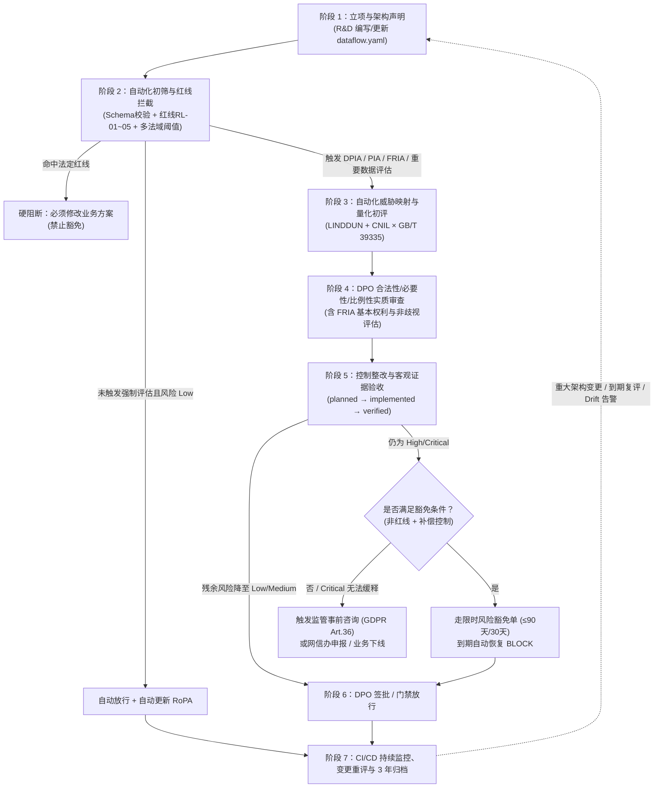

# 05. DPIA / PIA / FRIA 全生命周期作业流程（SOP）

| 文档属性 | 内容 |
| :--- | :--- |
| **文档编号** | `SOP-PRIV-005` |
| **版本号** | `v1.0` |
| **适用对象** | 业务负责人（BO）、研发团队（R&D）、隐私工程/信息安全（2LoD）、DPO / 法务合规 |
| **合规留存要求** | 依据 **PIPL 第 56 条** 及 **GDPR Art. 5(2) 问责原则**，本流程产出的所有评估报告、RoPA 台账、签批记录与豁免单据均须在不可篡改归档库中**至少保存 3 年**（重要数据及涉监管报送材料保存不少于 5 年） |

---

## 一、 端到端七阶段生命周期总览

---

## 二、 分阶段操作规程与入口/出口标准

### 阶段 1：立项与架构声明（Architecture Declaration）
* **触发时机**：新系统立项（PRD 评审通过后、进入开发前），或存量系统发生架构变更。
* **操作动作**：研发负责人在对应代码库根目录创建或更新 `dataflow.yaml`，如实声明系统元信息、数据资产（含敏感度与分类分级）、数据流向、存储与拟实施控制措施。
* **出口标准**：通过 JSON Schema 本地或 CI 校验，无字段拼写或悬空引用错误。

### 阶段 2：自动化阈值筛查与法定红线拦截（Automated Screening）
* **操作动作**：提交 Pull Request 后，CI 自动运行 DPIA-as-Code 引擎：
  1. 校验是否命中 **法定红线 `RL-01`–`RL-05`**（如命中 EU AI Act Art. 5 禁止类 AI、无合法性基础、重要数据违规出境等，立即硬阻断，无法豁免）；
  2. 并行判定 **GDPR WP29（≥2 项）**、**EU AI Act（高风险 AI / FRIA）**、**PIPL 第 55 条（任意 1 项）** 及 **中国重要数据/1000 万人阈值**；
  3. 同步输出语义 Diff 摘要至 PR 评论区（仅高亮本次 PR 新增或变更的数据流与风险变化）。
* **分流出口**：
  * 未命中红线、未触发任何强制评估且残余风险为 `Low` → 自动放行并刷新 RoPA 台账；
  * 命中任一强制评估阈值或残余风险 ≥ `Medium` → 进入阶段 3。

### 阶段 3：自动化威胁映射与量化初评（Automated Threat & Risk Scoring）
* **操作动作**：引擎自动生成 Mermaid DFD 数据流向图、GDPR Art. 30 / PIPL RoPA 草案、按节点映射 LINDDUN 隐私威胁清单、计算固有风险与残余风险分值，并基于 [04_control_catalog.md](file:///d:/claude_workplace/DPIA-as-Code/governance/04_control_catalog.md) 输出推荐控制项（`PC-xxx`）。
* **出口标准**：产出《综合影响评估初稿报告》（基于 [dpia_report_template.md](file:///d:/claude_workplace/DPIA-as-Code/governance/templates/dpia_report_template.md)）。

### 阶段 4：DPO 实质合规与比例性审查（Substantive Legal & FRIA Review）
* **为什么必须人工把关**：自动化引擎无法判断“采集人脸是否超出实现业务的最小必要限度”或“信用评分算法是否对特定年龄/性别群体存在隐性歧视”。
* **操作动作**：DPO 与法务合规团队基于阶段 3 初稿，重点审查并填写以下人工裁量结论：
  1. **合法性基础适格性**（特别排查中国业务误用 GDPR“合法利益”、敏感信息未设单独同意等问题）；
  2. **必要性与比例性原则**（是否存在更低隐私侵入性的替代技术方案）；
  3. **EU AI Act FRIA 专项审查**（如命中高风险 AI：审查非歧视性、透明度、人工监督可操作性）；
  4. **数据出境与重要数据专项定性**（确认是否涉及重要数据及对应网信办申报路径）。

### 阶段 5：控制整改与证据验收（Remediation & Assurance）
* **操作动作**：
  1. 研发团队依据推荐控制库落地技术/组织措施，在 `dataflow.yaml` 中将对应 `mitigations[].status` 从 `planned` 更新为 `implemented`，并附上可追溯证据（PR 链接、Terraform/K8s 配置路径、DPA 合同编号等）；
  2. 2LoD（隐私工程/信息安全）核验技术实现与证据真实性，验收通过后允许标记为 `verified`；
  3. 引擎重新计算残余风险。

### 阶段 6：审批决策、豁免或监管咨询（Sign-Off / Waiver / Escalation）
* **正常放行**：残余风险降至 `Low` / `Medium`（且高固有风险已获 `dpo_signoff.approved: true`）→ CI 门禁亮绿灯，允许 PR 合并上线。
* **限时风险豁免（Waiver）**：若非红线 `High` 风险因客观原因暂无法根治，业务负责人须填写 [risk_waiver_template.md](file:///d:/claude_workplace/DPIA-as-Code/governance/templates/risk_waiver_template.md)，经 2LoD 复核补偿性控制并由 DPO 审批通过后，在 `dataflow.yaml` 写入带硬性到期日（≤ 90 天）的豁免票据方可临时放行。
* **监管事前咨询 / 法定申报**：
  * **欧盟**：若采取一切合理措施后残余风险仍为 `Critical`，依据 **GDPR Art. 36** 暂停上线，由 DPO 向主管数据保护机构（Supervisory Authority）发起事前咨询；
  * **中国**：若命中数据出境安全评估/标准合同备案条件或涉及重要数据共享/出境，依据 **PIPL 第 38–40 条** 与 **《网络数据安全管理条例》** 须先完成网信办申报/备案后方可启用跨境数据流。

### 阶段 7：持续监控、变更重评与 3 年法定归档（Continuous Monitoring & Archiving）
* **持续监控与防漂移（Drift Guard）**：
  * 当研发修改敏感代码路径（如 `api/`、`migrations/`、第三方 SDK 依赖）却未同步更新 `dataflow.yaml` 时，CI 自动触发 Drift 警示并 `@` 隐私评审人介入核查；
  * 定时任务（Cron）每周巡检已过期豁免单据与满 12 个月未复评的高风险/重要数据系统。
* **法定归档留痕**：每次合并主干并生成最终评估报告后，自动将报告（Markdown/JSON）、对应 Git Commit SHA、RoPA 快照与签批记录归档至 WORM（只读防篡改）审计仓库，**留存期限不少于 3 年（1095 天）**。

---

## 三、 触发“强制重新评估”的重大变更清单

除定期复审（低风险 12 个月 / 中风险 6 个月 / 重要数据年度报送）外，发生以下任一情形时**必须立即重新运行本 SOP**：

1. **数据类型升级**：新增敏感个人信息（生物识别、金融、行踪、医疗、未成年人）或新识别出重要数据；
2. **处理目的或算法变更**：原有数据被用于新目的（如客服录音改用于大模型训练）、新增用户画像或自动化决策逻辑；
3. **第三方与跨境流向变更**：新增第三方 SDK/受托处理者/联合控制者，或数据存储/推理节点跨法域迁移；
4. **体量跨越法定阶梯**：涉及自然人规模跨越 **1 万（敏感出境）/ 10 万（大规模与标准合同）/ 100 万（出境安全评估）/ 1000 万（参照重要数据保护义务）** 任一法定阈值；
5. **安全事件或监管变动**：发生个人数据泄露事件、重大安全漏洞，或适用法域出台新的强制性法规/监管指南。
