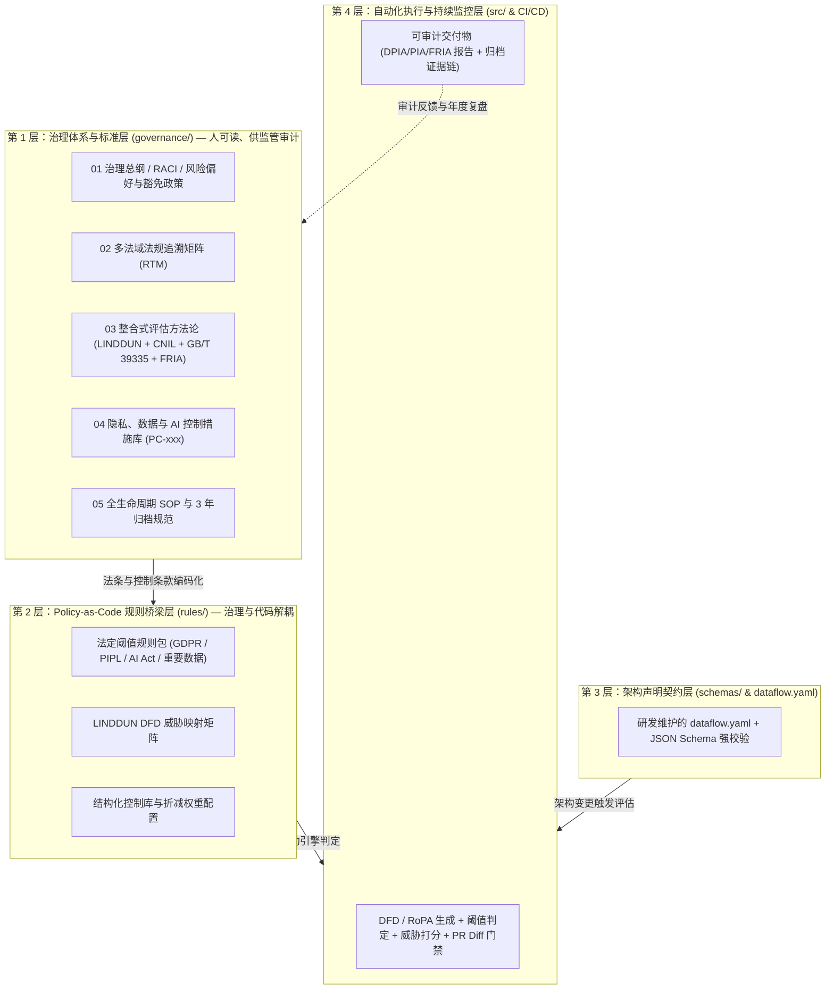

# DPIA-as-Code 隐私、数据安全与 AI 合规治理体系

> **核心理念：Governance First, Automated by Code（治理体系为本，工程代码为用）**
>
> 技术工具本身不能产生合规，严密的治理体系才能。本项目将自动化引擎定位为合规政策的**“执行翻译器、持续监测器与客观取证器”**——每一条自动化规则、每一个风险分值、每一次 CI/CD 门禁拦截，均严格追溯至本目录下的治理政策、法规条款与控制标准。

---

## 一、 为什么需要这套治理体系？（三个真实 GRC 痛点）

在企业数据与隐私合规实践中，传统治理模式普遍面临三个结构性失效：

1. **制度与现实的“双轨漂移”（Policy-Architecture Drift）**
   法务与合规团队在 Word/Confluence 中维护数百页制度，而研发在代码库中每周迭代数十次接口。当业务新增“人脸识别”、“用户画像”或接入一家境外 AI API 时，合规团队往往在上线数月甚至监管问询后才知情。
2. **多法域重复评估导致的“合规疲劳”（Assessment Fatigue）**
   同一项涉 AI 或跨境业务，可能同时触发欧盟 **GDPR DPIA**、**EU AI Act FRIA（基本权利影响评估）**、中国 **PIPL PIA（个人信息保护影响评估）** 以及 **《网络数据安全管理条例》重要数据风险评估**。按法规孤立建表会导致研发抵触、数据口径不一、整改项互相冲突。
3. **“纸面合规”与“永久豁免”陷阱（Checkbox Compliance）**
   在缺乏客观证据约束的问卷式评估中，业务方容易通过口头承诺（“计划下季度做脱敏”）换取上线放行，导致高风险长期滞留生产环境，既无法抵御真实隐私侵害，也经不起监管审计追责。

### 本体系的解题思路

* **一次建图，多法域映射（Assess Once, Comply Many）**：以架构声明文件 `dataflow.yaml` 作为研发与合规共享的**单一事实来源（Single Source of Truth, SSOT）**，一次数据流盘点同时驱动 GDPR、EU AI Act 与中国“三法两条例”的合规评估与台账生成。
* **法定红线与风险偏好双轨治理**：明确区分**绝对不可逾越的法定红线**（Zero-Tolerance，禁止风险接受）与**可管控的残余风险**（按风险偏好分级审批与限时豁免）。
* **证据驱动的控制成熟度管理**：严格区分控制措施的“设计有效（`planned`）”、“部署落地（`implemented`）”与“审计验证（`verified`）”，杜绝无证据的纸面降分。
* **人机分工边界清晰**：自动化引擎负责客观事实核验、阈值筛查、威胁初筛、量化打分与变更阻断；**合法性/必要性/比例性实质裁量、高风险豁免决策与监管沟通**，始终归属 DPO 与管理层。

---

## 二、 四层 GRC-as-Code 架构总览

---

## 三、 覆盖的权威法规与国际标准

| 体系维度 | 覆盖法规与标准 | 在本体系中的核心定位 |
| :--- | :--- | :--- |
| **中国“三法两条例”及配套** | 《网络安全法》（CSL）、《数据安全法》（DSL）、《个人信息保护法》（PIPL）、《关键信息基础设施安全保护条例》（CIIO 条例）、《网络数据安全管理条例》（国务院令第 790 号，2025 施行）、《促进和规范数据跨境流动规定》（2024）、GB/T 39335-2020、GB/T 43697-2024 | 中国境内数据分类分级、重要数据与 CIIO 保护、敏感信息单独同意、自动化决策、跨境合规路径、强制 PIA 与 3 年留存基线 |
| **欧盟隐私与 AI 法规** | **GDPR**（EU 2016/679）+ WP29/EDPB 9 项标准、**EU AI Act**（EU 2024/1689） | 欧盟个人数据合法性基础、Art. 30 RoPA、Art. 35/36 DPIA 与事前咨询、Art. 5 禁止类 AI 红线、Art. 6/Annex III 高风险 AI 与 Art. 27 FRIA |
| **方法论与国际 GRC 框架** | **LINDDUN** 隐私威胁建模、**CNIL PIA**、**ISO/IEC 27701**、**NIST Privacy Framework** | 提供结构化威胁分析矩阵、四级量化风险标尺以及跨国审计通用控制语言 |

---

## 四、 治理文档目录导航

| 编号 | 文档路径 | 核心内容 | 主要受众 |
| :---: | :--- | :--- | :--- |
| 01 | [01_governance_policy.md](file:///d:/claude_workplace/DPIA-as-Code/governance/01_governance_policy.md) | 治理原则、三道防线 RACI 矩阵、法定红线与风险偏好政策、例外/豁免治理 | 管理层、DPO、合规、研发负责人 |
| 02 | [02_regulatory_matrix.md](file:///d:/claude_workplace/DPIA-as-Code/governance/02_regulatory_matrix.md) | 多法域法规追溯矩阵（RTM）：法条 ↔ 规则 ID ↔ 观测字段 ↔ 审计证据 | DPO、法务、内外审、GRC 架构师 |
| 03 | [03_assessment_methodology.md](file:///d:/claude_workplace/DPIA-as-Code/governance/03_assessment_methodology.md) | 整合式评估方法论、LINDDUN 矩阵、CNIL × GB/T 39335 量化打分锚点与计算逻辑 | 隐私工程师、安全架构师、审计师 |
| 04 | [04_control_catalog.md](file:///d:/claude_workplace/DPIA-as-Code/governance/04_control_catalog.md) | 6 大控制域结构化控制库（`PC-xxx`）、威胁映射与审计验收证据清单 | 隐私/安全工程师、研发、审计师 |
| 05 | [05_dpia_lifecycle_sop.md](file:///d:/claude_workplace/DPIA-as-Code/governance/05_dpia_lifecycle_sop.md) | 端到端全生命周期作业流程（SOP）、变更触发重评、监管申报与 3 年归档机制 | 全员（业务、研发、合规、DPO） |
| T1 | [dpia_report_template.md](file:///d:/claude_workplace/DPIA-as-Code/governance/templates/dpia_report_template.md) | 审计级综合影响评估报告模板（整合 DPIA / PIA / FRIA / 重要数据评估） | DPO、业务负责人、外部监管/审计 |
| T2 | [ropa_template.md](file:///d:/claude_workplace/DPIA-as-Code/governance/templates/ropa_template.md) | GDPR Art. 30 & PIPL 处理活动记录（RoPA）标准台账模板 | DPO、数据治理团队 |
| T3 | [risk_waiver_template.md](file:///d:/claude_workplace/DPIA-as-Code/governance/templates/risk_waiver_template.md) | 高风险例外与风险接受申请单（含法定红线排除声明与强制到期日） | 业务风险接受人、DPO、信息安全 |

---

## 五、 体系治理与版本维护机制

* **归口管理**：本治理体系由 **数据保护官（DPO）/ 数据安全管理机构** 归口维护，至少每 12 个月或发生重大法规修订（如新司法解释、监管指南发布）后 30 日内完成复审更新。
* **变更留痕**：所有制度修订与 `rules/*.yaml` 规则调整必须通过受保护分支的 Pull Request 完成，由 DPO 与安全/隐私工程负责人双人复核合并，天然形成符合审计要求的版本变更轨迹。
